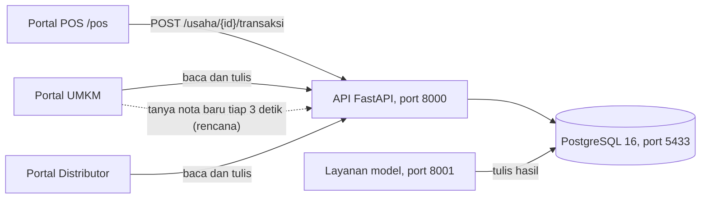

# Arsitektur Turnify Flow

Susunan komponen, alur data, dan lapisan aplikasi Turnify Flow. Bagian bertanda **(rencana)** belum ada di kode.
Kebutuhan produknya ada di [PRD.md](PRD.md), dan tabelnya di [SCHEMA.md](SCHEMA.md).

## Komponen dan alur data

- **Satu aplikasi, tiga portal.** Ketiga portal adalah rute dalam satu aplikasi React dengan kerangka masing-masing.
  Portal POS mengikuti pola Portal Distributor, yaitu `/pos` dengan halaman masuk `/masuk/pos`.
- **Dua portal bisa dibuka bersamaan.** Sesi disimpan di `sessionStorage`, jadi tiap tab atau jendela punya sesinya
  sendiri (`frontend/src/lib/api.ts`).
- **Nota adalah pintu masuk.** `POST /usaha/{id}/transaksi` (`backend/api/gudang.py`) menyimpan nota, menerjemahkan
  menu ke bahan lewat `pemetaan_menu`, menulis `pergerakan`, memotong `barang.stok`, dan menambah
  `permintaan_harian` dalam satu transaksi basis data. Nomor struk yang sama tidak diproses dua kali. Menu tanpa
  resep tetap masuk nota, dilaporkan, dan muncul di daftar yang perlu dipasangkan (`GET /usaha/{id}/menu-kasir`).
- **Model menulis ke tabel, API membaca tabel.** API tidak memanggil model saat halaman dibuka. Akibatnya nota baru
  langsung mengubah stok, tetapi prediksi baru berubah pada jadwal penjadwal berikutnya.
- **Tanggal data simulasi digeser (revisi V8).** Data simulasi dibangkitkan berakhir 5 Okt 2026. `dataset.geser_tanggal`,
  yang dijalankan `siapkan.cmd` dan `nyalakan.cmd` sebelum variasi demo, menggeser semua tanggalnya maju kelipatan 7 hari
  dalam satu transaksi, supaya data berakhir paling lambat kemarin dan pola harinya tetap. Yang ikut pindah: nota simulasi
  (bernomor `YYYYMMDD-UUU-NNN`, tanggal di nomornya ikut diganti), wilayah simulasi `permintaan_harian`, pergerakan,
  produksi, penjualan, dan pesanan buatan pembangkit beserta jejak, ulasan, dan fiturnya, serta jalan Mesin 1 yang
  berpangkal di akhir data simulasi. Baris buatan pembangkit dikenali dari id yang dicatat geseran pertama di
  `geseran_tanggal`, jadi nota Portal POS dan isian lewat layar tidak pernah ikut pindah. Bagian nota sungguhan di
  `permintaan_harian` dipisah dulu dan dikembalikan ke tanggalnya. Hari bolong antara akhir data dan nota sungguhan
  sesudahnya diisi nol berstatus stok habis, yang dibaca Mesin 1 sebagai data hilang. Di salinan basis data `0.3.0`
  geseran pertama (28 hari) butuh sekitar dua menit. Keluaran Mesin 2 dan 3 tidak digeser, karena dihitung ulang tiap
  empat jam.

## Portal POS

Keenam tahap sudah ada di kode (2026-10-31 sampai 2026-11-01), ditambah QR simulasi dari revisi V8.

- **Akun:** pemilik masuk ke Portal POS dengan akun usahanya, kasir dengan akun kasir (lihat Peran kasir).
- **Harga jual:** kolom `harga_jual`, `kategori`, dan `aktif` di `pemetaan_menu`, dibaca dan ditulis lewat `/usaha/{id}/menu-jual`. Menu tanpa harga tidak dijual di POS. `barang` tetap tanpa harga jual, karena
  yang dijual kasir adalah menu, bukan bahan. Tabel ini juga bisa menyimpan menu yang belum punya baris
  `pemetaan_menu_bahan`, jadi menu tanpa resep tetap tampil di POS.
- **Nomor struk:** dibuat di peramban sebelum dikirim, berawalan `POS-`, supaya kirim ulang tetap aman. Awalan `DEMO-`
  tidak boleh dipakai karena `backend/api/penjualan.py` tidak menghitungnya di Ringkasan Penjualan.
- **Pembayaran:** kolom `cara_bayar`, `diskon`, dan `uang_diterima` di `transaksi` (migrasi `d5a2c9e4f1b7`), diisi lewat badan `POST /usaha/{id}/transaksi`. Server menolak diskon di atas belanja dan uang tunai di bawah total (422), dan hanya menyimpan uang diterima untuk tunai. Kasir lama tanpa ketiganya tetap diterima. Ringkasan Penjualan menghitung total per nota dikurangi diskon dan merincinya per cara bayar. Sejak revisi V8 kasir hanya menawarkan tunai dan QRIS, dan server menolak `transfer` untuk nota baru (nota lama tetap terbaca, dan barisnya di Rincian hanya muncul kalau bukan nol). QRIS memakai QR simulasi.
- **Pembaruan langsung:** `KerangkaAplikasi` memanggil `periksaNotaMasuk` (store) tiap 3 detik selama tabnya terlihat. Aksi itu
  membaca satu nota terbaru dari `GET /usaha/{id}/transaksi?batas=1`. Kalau nomornya baru, ia memanggil `segarkanGudangServer` dan
  `muatMenuKasir` yang sudah ada, menyalakan baris stok yang berubah (`stokBerubah`), dan memunculkan pemberitahuan. Cara ini dipilih
  daripada WebSocket karena jedanya cukup untuk demo dan tidak menambah infrastruktur.
- **Pengaturan satu arah:** menu, harga, dan resep ditulis dari Portal UMKM. Portal POS hanya membaca menu aktif yang punya
  harga, dan mengirim nama menu di nota. Server yang menerjemahkan menu ke bahan.
- **Daftar nota:** sejak revisi V7 `DaftarNota` di Ringkasan Penjualan menampilkan 5 nota terbaru dan menautkan ke halaman Riwayat
  Kasir (`/penjualan/riwayat`, tab Nota dan Shift), yang memuat 25 tiap kali. `GET /usaha/{id}/transaksi` menerima `batas`
  (paling banyak 50) dan `mulai`, tidak memuat nota `DEMO-`, dan baris notanya membawa harga satuan.
- **Pembatalan nota:** `POST /usaha/{id}/transaksi/{nomor}/ajukan-batal` (kasir, hanya mencatat alasan di `pengajuan_batal`) dan `.../batal` (pemilik). Pembatalan mengunci barisnya, mengembalikan persis yang dipotong nota itu lewat pergerakan `koreksi` yang menunjuk nota yang sama (jadi jumlah semua pergerakan tetap sama dengan stok), mengurangi `permintaan_harian`, lalu menandai `dibatalkan`. Aman diulang. Nomor nota batal tetap terpakai. Ringkasan, daftar nota, dan menu kasir sudah mengabaikan nota batal. Pembatalan hanya untuk pemilik, ditegakkan server lewat jenis token (lihat Peran kasir).
- **Peran kasir:** akun kasir adalah `pengguna` dengan `keanggotaan` berperan pegawai, dibuat pemilik lewat `POST /usaha/{id}/kasir` dan masuk lewat `POST /auth/pos/masuk`. Tokennya berjenis `kasir`, bukan `umkm`. `usaha_saya` hanya menerima `umkm`, jadi semua endpoint ditolak bagi kasir kecuali yang memakai `kasir_atau_pemilik`: `POST` dan `GET /transaksi`, `GET /menu-jual`, `POST .../ajukan-batal`, shift, dan QR simulasi (`/qr`). Pintu `/auth/umkm/masuk` menolak akun kasir. Daftar terbuka sengaja pendek: endpoint baru otomatis tertutup bagi kasir sampai ada yang sengaja membukanya.
- **Shift kas:** tabel `shift_kas` (satu shift terbuka per usaha, dijaga indeks unik sebagian). Nota yang masuk saat shift terbuka diberi `shift_id`. Saat ditutup, rekap tunai, QRIS, dan transfer (nol untuk nota sejak revisi V8) dibekukan dan selisih = uang dihitung dikurangi (modal + tunai). Hanya tunai yang masuk laci. Pembatalan nota sesudah shift ditutup tidak mengubah rekap itu.
- **QR simulasi (revisi V8):** tabel `pembayaran_qr` (migrasi `b8e2f5a1c4d7`). Kasir membuat tagihan lewat `POST /usaha/{id}/qr`
  (nomor nota dan jumlah). Layar menggambar QR berisi tautan `<alamat>/bayar/{token}` (pustaka `qrcode-generator`) dan menanyakan
  `GET /usaha/{id}/qr/{token}` tiap 1,5 detik selama tabnya terlihat. HP di jaringan yang sama membuka halaman itu tanpa masuk, dan
  halamannya mem-POST `/bayar/{token}/lunas`, bukan saat dimuat, supaya pratinjau tautan tidak ikut melunasi. Begitu lunas, layar kasir
  mengirim notanya sebagai QRIS. Tombol "Anggap Sudah Dibayar" memanggil `POST /usaha/{id}/qr/{token}/lunas`, untuk jaringan yang tidak
  bisa dijangkau HP. Tagihan kedaluwarsa 10 menit. Awal tautan diambil dari `WARUNGKU_ALAMAT_QR` (`siapkan.ps1` mengisinya dengan
  alamat Wi-Fi laptop, karena kontainer tidak bisa melihatnya), atau dideteksi sendiri oleh API yang berjalan langsung di laptop
  (`nyalakan.cmd`, yang karena itu mendengar di `0.0.0.0`). Bukan QRIS: isinya tautan biasa, tanpa logo QRIS, berlabel simulasi.
- **Pemasangan resep:** memakai layar `KasirPasangkan` dan `PUT /usaha/{id}/menu-kasir` yang sudah ada, ditambah tombol Pakai Resep
  Saran yang mengisi isian dari `frontend/src/lib/resepSaran.ts`. Menu tanpa resep juga muncul sebagai pemberitahuan di lonceng. Resep sarannya tercatat di [PRD.md](PRD.md).

## Peta folder

| Folder | Isi |
|---|---|
| `frontend/src/pages/`, `layouts/` | Halaman dan kerangka tiap portal. Portal POS: `pages/pos/`, `layouts/KerangkaPos.tsx`, `pages/auth/MasukPos.tsx` |
| `frontend/src/store/aplikasi.ts` | Store Zustand |
| `frontend/src/lib/api*.ts` | Klien API |
| `backend/api/` | Endpoint REST |
| `backend/warungku/model/` | Model tabel SQLModel |
| `backend/migrations/` | Migrasi Alembic |
| `backend/uji/` | Uji API |
| `ml/` | Mesin 1, 2, 3 dan layanan model |
| `data/` | Pembangkit data simulasi dan data nyata pihak luar |
| `deployment/` | `docker-compose.yml`, Dockerfile, image basis data |
| `tools/lokal/` | Skrip `siapkan`, `nyalakan`, `matikan` |

## Cara menjalankan

Lihat [README.md](README.md) bagian Mulai cepat. Singkatnya `nyalakan.cmd` di akar repo menyalakan semuanya, dan
`matikan.cmd` mematikannya. Semua perintah dijalankan dari akar repo.

## Lapisan aplikasi

| Lapisan | Keadaan sekarang |
|---|---|
| Front end | React 19, Vite 7, Tailwind v4, react-router-dom 7, Zustand. Tetap jalan dengan data contoh kalau API mati |
| API | FastAPI |
| Data | PostgreSQL 16, SQLModel, Alembic |
| Auth | JWT dan kata sandi argon2. Tiap endpoint usaha memeriksa token lewat `usaha_saya`. Belum ada penyegaran token dan OTP |
| Hosting | Lokal lewat Docker Compose. Belum dipasang di server. API terbuka ke jaringan lokal (port 8000) supaya HP bisa membuka QR simulasi. Selain halaman `/bayar/{token}`, semua endpoint tetap butuh token |
| Compute | Layanan model terpisah dengan penjadwal (02.00 dan tiap 4 jam) |
| CI/CD | Belum ada. Repo tidak punya `.github/workflows` |
| Row-level security | Tidak dipakai. Akses dijaga di API |
| Rate limiting | Belum ada |
| Cache dan CDN | Belum ada |
| Scaling | Belum dirancang. Satu instans tiap layanan |
| Error tracking dan log | Belum ada layanan khusus |
| Recovery | Image basis data di Docker Hub dan cadangan `deployment/db/*.dump` (tidak dilacak git) |
