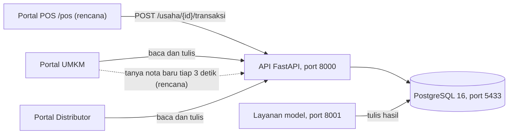

# Arsitektur Turnify Flow

Susunan komponen, alur data, dan lapisan aplikasi Turnify Flow. Bagian bertanda **(rencana)** belum ada di kode.
Kebutuhan produknya ada di [PRD.md](PRD.md).

## Komponen dan alur data

- **Satu aplikasi, tiga portal.** Ketiga portal adalah rute dalam satu aplikasi React dengan kerangka masing-masing.
  Portal POS mengikuti pola Portal Distributor, yaitu `/pos` dengan halaman masuk `/masuk/pos`.
- **Dua portal bisa dibuka bersamaan.** Sesi disimpan di `sessionStorage`, jadi tiap tab atau jendela punya sesinya
  sendiri (`frontend/src/lib/api.ts`).
- **Nota adalah pintu masuk.** `POST /usaha/{id}/transaksi` (`backend/api/gudang.py`) menyimpan nota, menerjemahkan
  menu ke bahan lewat `pemetaan_menu`, menulis `pergerakan`, memotong `barang.stok`, dan menambah
  `permintaan_harian` dalam satu transaksi basis data. Nomor struk yang sama tidak diproses dua kali. Menu tanpa
  resep tetap masuk nota, dilaporkan, dan muncul di daftar yang perlu dipasangkan (`GET /usaha/{id}/menu-kasir`).
- **Model menulis ke tabel, API membaca tabel.** API tidak memanggil model saat halaman dibuka. Akibatnya nota baru
  langsung mengubah stok, tetapi prediksi baru berubah pada jadwal penjadwal berikutnya.

## Keputusan Portal POS (rencana)

- **Akun:** tahap awal memakai akun usaha yang sudah ada. Token dan penjagaan `usaha_saya` tidak berubah. Akun kasir
  khusus menyusul di tahap 5.
- **Harga jual:** kolom baru di `pemetaan_menu` (harga jual, kategori, aktif). `barang` tetap tanpa harga jual, karena
  yang dijual kasir adalah menu, bukan bahan. Tabel ini juga bisa menyimpan menu yang belum punya baris
  `pemetaan_menu_bahan`, jadi menu tanpa resep tetap tampil di POS.
- **Nomor struk:** dibuat di peramban sebelum dikirim, berawalan `POS-`, supaya kirim ulang tetap aman. Awalan `DEMO-`
  tidak boleh dipakai karena `backend/api/penjualan.py` tidak menghitungnya di Ringkasan Penjualan.
- **Pembayaran:** kolom cara bayar, diskon, dan uang diterima di `transaksi`.
- **Pembaruan langsung:** Portal UMKM menanyakan nota terakhir tiap 3 detik selama tabnya terlihat, lewat endpoint
  ringan. Kalau ada yang baru, ia memanggil `segarkanGudangServer` dan `muatMenuKasir` yang sudah ada. Cara ini dipilih
  daripada WebSocket karena jedanya cukup untuk demo dan tidak menambah infrastruktur.
- **Pengaturan satu arah:** menu, harga, dan resep ditulis dari Portal UMKM. Portal POS hanya membaca menu aktif yang punya
  harga, dan mengirim nama menu di nota. Server yang menerjemahkan menu ke bahan.
- **Daftar nota:** ringkasan nota dan Lihat Semua Nota ada di Ringkasan Penjualan. `GET /usaha/{id}/transaksi` sekarang
  paling banyak mengembalikan 50 nota, jadi perlu halaman.
- **Pemasangan resep:** memakai layar `KasirPasangkan` dan `PUT /usaha/{id}/menu-kasir` yang sudah ada, ditambah tombol
  yang mengisi resep saran demo. Resep sarannya tercatat di [PRD.md](PRD.md).

## Peta folder

| Folder | Isi |
|---|---|
| `frontend/src/pages/`, `layouts/` | Halaman dan kerangka tiap portal |
| `frontend/src/store/aplikasi.ts` | Store Zustand |
| `frontend/src/lib/api*.ts` | Klien API |
| `backend/api/` | Endpoint REST |
| `backend/warungku/model/` | Model tabel SQLModel |
| `backend/migrations/` | Migrasi Alembic |
| `backend/uji/` | Uji API |
| `ml/` | Mesin 1, 2, 3 dan layanan model |
| `data/` | Pembangkit data simulasi dan data nyata pihak luar |
| `deployment/` | `docker-compose.yml`, Dockerfile, image basis data |
| `tools/lokal/` | Skrip `siapkan`, `nyalakan`, `matikan` |

## Cara menjalankan

Lihat [README.md](README.md) bagian Mulai cepat. Singkatnya `nyalakan.cmd` di akar repo menyalakan semuanya, dan
`matikan.cmd` mematikannya. Semua perintah dijalankan dari akar repo.

## Lapisan aplikasi

| Lapisan | Keadaan sekarang |
|---|---|
| Front end | React 19, Vite 7, Tailwind v4, react-router-dom 7, Zustand. Tetap jalan dengan data contoh kalau API mati |
| API | FastAPI |
| Data | PostgreSQL 16, SQLModel, Alembic |
| Auth | JWT dan kata sandi argon2. Tiap endpoint usaha memeriksa token lewat `usaha_saya`. Belum ada penyegaran token dan OTP |
| Hosting | Lokal lewat Docker Compose. Belum dipasang di server |
| Compute | Layanan model terpisah dengan penjadwal (02.00 dan tiap 4 jam) |
| CI/CD | Belum ada. Repo tidak punya `.github/workflows` |
| Row-level security | Tidak dipakai. Akses dijaga di API |
| Rate limiting | Belum ada |
| Cache dan CDN | Belum ada |
| Scaling | Belum dirancang. Satu instans tiap layanan |
| Error tracking dan log | Belum ada layanan khusus |
| Recovery | Image basis data di Docker Hub dan cadangan `deployment/db/*.dump` (tidak dilacak git) |
