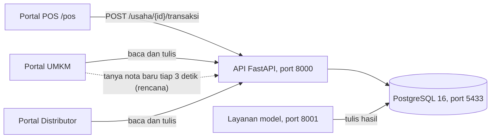

# Arsitektur Turnify Flow

Susunan komponen, alur data, dan lapisan aplikasi Turnify Flow. Bagian bertanda **(rencana)** belum ada di kode.
Kebutuhan produknya ada di [PRD.md](PRD.md), dan tabelnya di [SCHEMA.md](SCHEMA.md).

## Komponen dan alur data

- **Satu aplikasi, tiga portal.** Ketiga portal adalah rute dalam satu aplikasi React dengan kerangka masing-masing.
  Portal POS mengikuti pola Portal Distributor, yaitu `/pos` dengan halaman masuk `/masuk/pos`.
- **Dua portal bisa dibuka bersamaan.** Sesi disimpan di `sessionStorage`, jadi tiap tab atau jendela punya sesinya
  sendiri (`frontend/src/lib/api.ts`).
- **Stok diubah lewat endpoint, bukan di peramban (audit 3 Nov 2026).** Tambah Barang, Ubah Barang, Koreksi Stok, Catat
  Pemakaian, Batas Aman (satu dan massal), dan Kelola Kategori memanggil `backend/api/stok.py` di mode data server. Dulu
  semuanya hanya mengubah store, jadi hilang saat halaman dimuat ulang. Stok awal dan koreksi dicatat sebagai pergerakan
  `koreksi`, pemakaian manual sebagai `terjual`, sehingga invarian stok sama dengan jumlah pergerakan tetap berlaku.
- **Batas aman dan saran beli (keputusan 4 Nov 2026).** Mesin 1 menulis `barang.batas_aman_saran` (jumlah p90 selama
  `hari_kirim`) dan `batas_aman` untuk barang bersumber `sistem`, di transaksi yang sama dengan `prediksi`
  (`backend/warungku/batas_aman.py`). `dataset.variasi_demo` memanggil fungsi yang sama saat aplikasi disiapkan, jadi basis
  data dari image tidak menunggu jadwal 02.00. `rekomendasiDari` di frontend memakai aturan pesan ulang yang disimulasikan di
  laporan, dengan `dalam_perjalanan` dari `GET /barang` dan `perkiraan_persediaan` dari `GET /pemakaian-bulanan`.
- **Profil, penilaian, draf, dan pengajuan kontrak juga lewat endpoint (audit 3 Nov 2026).** Layar Akun (Profil
  Usaha, Data Usaha, Cara Hitung Stok) memakai `GET` dan `PATCH /usaha/{id}/profil` (`backend/api/profil.py`). Beri
  Penilaian menulis ke tabel `ulasan`, yang dibaca katalog dan fitur Mesin 2. Draf pesanan bisa dikirim (`/ajukan`)
  dan dibatalkan, dan pengajuan kontrak yang belum dijawab bisa ditarik (`/tarik`). Kontrol yang belum punya jalur ke
  server (bukti bayar, permintaan pembatalan, pengingat, undangan pengguna, jadwal pesanan rutin) menampilkan
  `CatatanPurwarupa` di mode data server, bukan pesan "tersimpan".
- **Barang yang dijual distributor tersimpan di server (keputusan 4 Nov 2026).** `backend/api/katalog.py` menulis `penawaran`.
  Barang baru tertaut ke `produk_master` menurut namanya, supaya masuk ke gudang pembeli: pembeli yang belum punya barangnya
  mendapat baris `barang` baru saat barang diterima (`backend/api/pesanan.py`). Menyembunyikan barang tidak menghentikan
  kontrak yang berjalan, tetapi saran Mesin 2 tidak lagi menawarkannya.
- **Tab Produksi memakai satu struktur (keputusan 4 Nov 2026).** Struktur Bu Ratmi (Menu, Sesi Masak, Kiriman ke pembeli)
  berlaku untuk semua jenis usaha. Kafe (`JENIS_KONTER` di `frontend/src/pages/produksi/Produksi.tsx`) hanya mendapat tab
  Menu karena tidak melayani pesanan partai besar, dan usaha selain produsen tetap mengatur menu Portal POS di tab Menu.
  Kartu dan formulir komposisi bersama ada di `frontend/src/pages/produksi/komposisi.tsx`. Sesi masak ikut menulis
  `permintaan_harian`, jadi Mesin 1 melihat pemakaian bahan untuk produksi.
- **Warung Madura ditambahkan skrip, bukan lewat image basis data (revisi V8, Q175 sampai Q177).** `data/dataset/warung_madura.py`
  menambah satu warung, 153 produk baru, dan empat distributor kelontong dengan generator acaknya sendiri, jadi data dan
  statistik Mesin 2 yang lama tidak berubah. Simulasinya memakai kalender asli, lalu tanggalnya digeser sebanyak geseran yang
  berlaku dan barisnya didaftarkan ke `geseran_tanggal`. `siapkan.cmd` dan `nyalakan.cmd` menjalankannya sesudah geseran dan
  sebelum variasi demo. Warung kelontong tidak punya tab Produksi. Kedai dan produsen tidak melihat barang kelompok kelontong
  di Belanja kecuali mencarinya (`KATEGORI_KELONTONG`). Promo disaring serupa oleh `promoUntukUsaha`: kedai dan produsen tidak
  melihat promo kelontong, dan warung kelontong hanya melihat promo kelompok kelontong atau kategori yang ada di gudangnya.
- **Identitas portal distributor.** `useDistributorAktif` menimpa profil contoh dengan id, nama, kota, warna, dan tanggal
  bergabung dari `/distributor/{id}/profil`, jadi halaman portal menyaring dan menyapa sesuai akun yang masuk, bukan
  distributor nomor 1. Tanpa server, portal tetap memakai toko contoh.
- **Pemasok yang disarankan.** `GET /usaha/{id}/barang` membawa `penawaran_saran_id`, penawaran teratas Mesin 2 untuk tiap
  barang, dan `penawaranSaranUntuk` memakainya untuk semua saran beli. Barang dengan dua pemasok jadi menunjuk distributor yang
  sama di Stok, Prediksi, dan Beranda. Kalau Mesin 2 belum menilainya, yang dipakai penawaran pertama di katalog.
- **Jam nota simulasi.** Jam nota simulasi adalah jam setempat yang ditulis apa adanya di kolom UTC, dan semua tanggal usaha di
  backend dihitung dengan `AT TIME ZONE 'UTC'`. Saat ditampilkan, `waktu_nota` di `backend/api/gudang.py` memundurkannya 7 jam untuk
  nota bernomor simulasi supaya terbaca sebagai WIB. Nota dari kasir sungguhan menyimpan waktu sebenarnya dan tidak diubah.
- **Riwayat pergerakan.** Detail stok membaca buku besar lewat `GET /usaha/{id}/barang/{id}/pergerakan`, 30 baris tiap halaman
  (`useRiwayatPergerakan`), karena satu barang bisa punya ratusan baris dan buku besar usaha tidak pernah dimuat ke peramban.
  Tanpa server, panelnya tetap membaca data contoh di store. Baris pembangkit tidak punya nota dan jamnya tepat di menit,
  sedangkan semua jalur tulis aplikasi membawa detik dan mikrodetik, jadi aturan 7 jam yang sama berlaku untuk baris itu saja.
  `GET /usaha/{id}/barang` membawa `terakhir_berubah`, waktu pergerakan terakhir tiap barang dengan aturan yang sama, untuk
  urutan Terakhir berubah di daftar Stok dan peringatan saat isi kemasan diubah.
- **Jam pesanan simulasi.** Waktu pesanan, jejak, perkiraan tiba, waktu sampai, dan ulasan buatan pembangkit juga jam setempat di
  kolom UTC dan tepat di menit. Rute pesanan dan ulasan membacanya lewat `waktu_pesanan` dan `WAKTU_PESANAN` di
  `backend/api/gudang.py`, termasuk untuk urutan, supaya terbaca sebagai WIB dan urut dengan baris sungguhan. Kolomnya sendiri tetap,
  karena tanggal usaha dan Mesin 2 membacanya apa adanya. Jejak berangkat simulasi yang lama pukul 07.00 mendahului pesanan yang
  masuk pukul 08.00, jadi `perbaiki_simulasi` memindahkannya ke 13.00, sama dengan pembangkit sekarang.
- **Daftar pesanan berhalaman.** Kedua portal memuat 100 pesanan terbaru, sisanya lewat Muat pesanan lebih lama (`mulai`).
  Pesanan lama yang dibuka dari tautan diambil sendiri lewat `GET /pesanan/{id}`.
- **Nota adalah pintu masuk.** `POST /usaha/{id}/transaksi` (`backend/api/gudang.py`) menyimpan nota, menerjemahkan
  menu ke bahan lewat `pemetaan_menu`, menulis `pergerakan`, memotong `barang.stok`, dan menambah
  `permintaan_harian` dalam satu transaksi basis data. Nomor struk yang sama tidak diproses dua kali. Menu tanpa
  resep tetap masuk nota, dilaporkan, dan muncul di daftar yang perlu dipasangkan (`GET /usaha/{id}/menu-kasir`).
- **Model menulis ke tabel, API membaca tabel.** API tidak memanggil model saat halaman dibuka. Akibatnya nota baru
  langsung mengubah stok, tetapi prediksi baru berubah pada jadwal penjadwal berikutnya.
- **Mesin 1 melengkapi hari bolong.** Data simulasi punya satu baris `permintaan_harian` per barang per hari, tetapi nota
  Portal POS hanya menulis baris pada hari bahannya terpakai. Pemuat Mesin 1 (`ml/data.py`, `_isi_bolong`) melengkapi
  hari yang hilang saat memuat deret: nol kalau usaha itu tercatat berjualan barang lain hari itu, dan disensor seperti
  hari stok habis kalau tidak ada penjualan sama sekali (misalnya aplikasi tidak dibuka). Tabelnya tetap hanya berisi yang
  tercatat. Sebelumnya hari bolong menghentikan seluruh jalan Mesin 1.
- **Tanggal data simulasi digeser (revisi V8).** Data simulasi dibangkitkan berakhir 5 Okt 2026. `dataset.geser_tanggal`,
  yang dijalankan `siapkan.cmd` dan `nyalakan.cmd` sebelum variasi demo, menggeser semua tanggalnya maju kelipatan 7 hari
  dalam satu transaksi, supaya data berakhir paling lambat kemarin dan pola harinya tetap. Yang ikut pindah: nota simulasi
  (bernomor `YYYYMMDD-UUU-NNN`, tanggal di nomornya ikut diganti), wilayah simulasi `permintaan_harian`, pergerakan,
  produksi, penjualan, dan pesanan buatan pembangkit beserta jejak, ulasan, dan fiturnya, serta jalan Mesin 1 yang
  berpangkal di akhir data simulasi. Baris buatan pembangkit dikenali dari id yang dicatat geseran pertama di
  `geseran_tanggal`, jadi nota Portal POS dan isian lewat layar tidak pernah ikut pindah. Bagian nota sungguhan di
  `permintaan_harian` dipisah dulu dan dikembalikan ke tanggalnya. Hari bolong di antara akhir data dan nota sungguhan
  sesudahnya dilengkapi Mesin 1 saat memuat deret (butir di atas). Di salinan basis data `0.3.0`
  geseran pertama (28 hari) butuh sekitar dua menit. Keluaran Mesin 2 dan 3 tidak digeser, karena dihitung ulang tiap
  empat jam.

## Portal POS

Keenam tahap sudah ada di kode (2026-10-31 sampai 2026-11-01), ditambah QR simulasi dari revisi V8.

- **Akun:** pemilik masuk ke Portal POS dengan akun usahanya, kasir dengan akun kasir (lihat Peran kasir).
- **Harga jual:** kolom `harga_jual`, `kategori`, dan `aktif` di `pemetaan_menu`, dibaca dan ditulis lewat `/usaha/{id}/menu-jual`. Menu tanpa harga tidak dijual di POS. `barang` tetap tanpa harga jual, karena
  yang dijual kasir adalah menu, bukan bahan. Tabel ini juga bisa menyimpan menu yang belum punya baris
  `pemetaan_menu_bahan`, jadi menu tanpa resep tetap tampil di POS.
- **Nomor struk:** dibuat di peramban sebelum dikirim, berawalan `POS-`, supaya kirim ulang tetap aman. Awalan `DEMO-`
  tidak boleh dipakai karena `backend/api/penjualan.py` tidak menghitungnya di Ringkasan Penjualan.
- **Pembayaran:** kolom `cara_bayar`, `diskon`, dan `uang_diterima` di `transaksi` (migrasi `d5a2c9e4f1b7`), diisi lewat badan `POST /usaha/{id}/transaksi`. Server menolak diskon di atas belanja dan uang tunai di bawah total (422), dan hanya menyimpan uang diterima untuk tunai. Kasir lama tanpa ketiganya tetap diterima. Ringkasan Penjualan menghitung total per nota dikurangi diskon dan merincinya per cara bayar. Sejak revisi V8 kasir hanya menawarkan tunai dan QRIS, dan server menolak `transfer` untuk nota baru (nota lama tetap terbaca, dan barisnya di Rincian hanya muncul kalau bukan nol). QRIS memakai QR simulasi.
- **Pembaruan langsung:** `KerangkaAplikasi` memanggil `periksaNotaMasuk` (store) tiap 3 detik selama tabnya terlihat. Aksi itu
  membaca satu nota terbaru dari `GET /usaha/{id}/transaksi?batas=1`. Kalau nomornya baru, ia memanggil `segarkanGudangServer` dan
  `muatMenuKasir` yang sudah ada, menyalakan baris stok yang berubah (`stokBerubah`), dan memunculkan pemberitahuan. Cara ini dipilih
  daripada WebSocket karena jedanya cukup untuk demo dan tidak menambah infrastruktur.
- **Pengaturan satu arah:** menu, harga, dan resep ditulis dari Portal UMKM. Portal POS hanya membaca menu aktif yang punya
  harga, dan mengirim nama menu di nota. Server yang menerjemahkan menu ke bahan.
- **Daftar nota:** sejak revisi V7 `DaftarNota` di Ringkasan Penjualan menampilkan 5 nota terbaru dan menautkan ke halaman Riwayat
  Kasir (`/penjualan/riwayat`, tab Nota dan Shift), yang memuat 25 tiap kali. `GET /usaha/{id}/transaksi` menerima `batas`
  (paling banyak 50) dan `mulai`, tidak memuat nota `DEMO-`, dan baris notanya membawa harga satuan.
- **Pembatalan nota:** `POST /usaha/{id}/transaksi/{nomor}/ajukan-batal` (kasir, hanya mencatat alasan di `pengajuan_batal`) dan `.../batal` (pemilik). Pembatalan mengunci barisnya, mengembalikan persis yang dipotong nota itu lewat pergerakan `koreksi` yang menunjuk nota yang sama (jadi jumlah semua pergerakan tetap sama dengan stok), mengurangi `permintaan_harian`, lalu menandai `dibatalkan`. Aman diulang. Nomor nota batal tetap terpakai. Ringkasan, daftar nota, dan menu kasir sudah mengabaikan nota batal. Pembatalan hanya untuk pemilik, ditegakkan server lewat jenis token (lihat Peran kasir).
- **Peran kasir:** akun kasir adalah `pengguna` dengan `keanggotaan` berperan pegawai, dibuat pemilik lewat `POST /usaha/{id}/kasir` dan masuk lewat `POST /auth/pos/masuk`. Tokennya berjenis `kasir`, bukan `umkm`. `usaha_saya` hanya menerima `umkm`, jadi semua endpoint ditolak bagi kasir kecuali yang memakai `kasir_atau_pemilik`: `POST` dan `GET /transaksi`, `GET /menu-jual`, `POST .../ajukan-batal`, shift, dan QR simulasi (`/qr`). Pintu `/auth/umkm/masuk` menolak akun kasir. Daftar terbuka sengaja pendek: endpoint baru otomatis tertutup bagi kasir sampai ada yang sengaja membukanya.
- **Shift kas:** tabel `shift_kas` (satu shift terbuka per usaha, dijaga indeks unik sebagian). Nota yang masuk saat shift terbuka diberi `shift_id`. Saat ditutup, rekap tunai, QRIS, dan transfer (nol untuk nota sejak revisi V8) dibekukan dan selisih = uang dihitung dikurangi (modal + tunai). Hanya tunai yang masuk laci. Pembatalan nota sesudah shift ditutup tidak mengubah rekap itu.
- **QR simulasi (revisi V8):** tabel `pembayaran_qr` (migrasi `b8e2f5a1c4d7`). Kasir membuat tagihan lewat `POST /usaha/{id}/qr`
  (nomor nota dan jumlah). Layar menggambar QR berisi tautan `<alamat>/bayar/{token}` (pustaka `qrcode-generator`) dan menanyakan
  `GET /usaha/{id}/qr/{token}` tiap 1,5 detik selama tabnya terlihat. HP di jaringan yang sama membuka halaman itu tanpa masuk, dan
  halamannya mem-POST `/bayar/{token}/lunas`, bukan saat dimuat, supaya pratinjau tautan tidak ikut melunasi. Begitu lunas, layar kasir
  mengirim notanya sebagai QRIS. Tombol "Anggap Sudah Dibayar" memanggil `POST /usaha/{id}/qr/{token}/lunas`, untuk jaringan yang tidak
  bisa dijangkau HP. Tagihan kedaluwarsa 10 menit. Awal tautan diambil dari `WARUNGKU_ALAMAT_QR` (`siapkan.ps1` mengisinya dengan
  alamat Wi-Fi laptop, karena kontainer tidak bisa melihatnya), atau dideteksi sendiri oleh API yang berjalan langsung di laptop
  (`nyalakan.cmd`, yang karena itu mendengar di `0.0.0.0`). Bukan QRIS: isinya tautan biasa, tanpa logo QRIS, berlabel simulasi.
- **Pemasangan resep:** memakai layar `KasirPasangkan` dan `PUT /usaha/{id}/menu-kasir` yang sudah ada, ditambah tombol Pakai Resep
  Saran yang mengisi isian dari `frontend/src/lib/resepSaran.ts`. Menu tanpa resep juga muncul sebagai pemberitahuan di lonceng. Resep sarannya tercatat di [PRD.md](PRD.md).

## Peta folder

| Folder | Isi |
|---|---|
| `frontend/src/pages/`, `layouts/` | Halaman dan kerangka tiap portal. Portal POS: `pages/pos/`, `layouts/KerangkaPos.tsx`, `pages/auth/MasukPos.tsx` |
| `frontend/src/store/aplikasi.ts` | Store Zustand |
| `frontend/src/lib/api*.ts` | Klien API |
| `backend/api/` | Endpoint REST |
| `backend/warungku/model/` | Model tabel SQLModel |
| `backend/migrations/` | Migrasi Alembic |
| `backend/uji/` | Uji API |
| `ml/` | Mesin 1, 2, 3 dan layanan model |
| `data/` | Pembangkit data simulasi dan data nyata pihak luar |
| `deployment/` | `docker-compose.yml`, Dockerfile, image basis data |
| `tools/lokal/` | Skrip `siapkan`, `nyalakan`, `matikan` |

## Cara menjalankan

Lihat [README.md](README.md) bagian Mulai cepat. Singkatnya `nyalakan.cmd` di akar repo menyalakan semuanya, dan
`matikan.cmd` mematikannya. Semua perintah dijalankan dari akar repo.

## Lapisan aplikasi

| Lapisan | Keadaan sekarang |
|---|---|
| Front end | React 19, Vite 7, Tailwind v4, react-router-dom 7, Zustand. Tetap jalan dengan data contoh kalau API mati, dengan penanda tetap `PitaDataContoh` di kerangka supaya data contoh tidak terbaca sebagai data usaha (`alasanContoh` di store membedakan sengaja mencoba dan gagal dimuat) |
| API | FastAPI |
| Data | PostgreSQL 16, SQLModel, Alembic |
| Auth | JWT dan kata sandi argon2. Tiap endpoint usaha memeriksa token lewat `usaha_saya`. Belum ada penyegaran token dan OTP |
| Hosting | Lokal lewat Docker Compose. Belum dipasang di server. API terbuka ke jaringan lokal (port 8000) supaya HP bisa membuka QR simulasi. Selain halaman `/bayar/{token}`, semua endpoint tetap butuh token |
| Compute | Layanan model terpisah dengan penjadwal (02.00 dan tiap 4 jam) |
| CI/CD | Belum ada. Repo tidak punya `.github/workflows` |
| Row-level security | Tidak dipakai. Akses dijaga di API |
| Rate limiting | Belum ada |
| Cache dan CDN | Belum ada |
| Scaling | Belum dirancang. Satu instans tiap layanan |
| Error tracking dan log | Belum ada layanan khusus |
| Recovery | Image basis data di Docker Hub dan cadangan `deployment/db/*.dump` (tidak dilacak git) |
