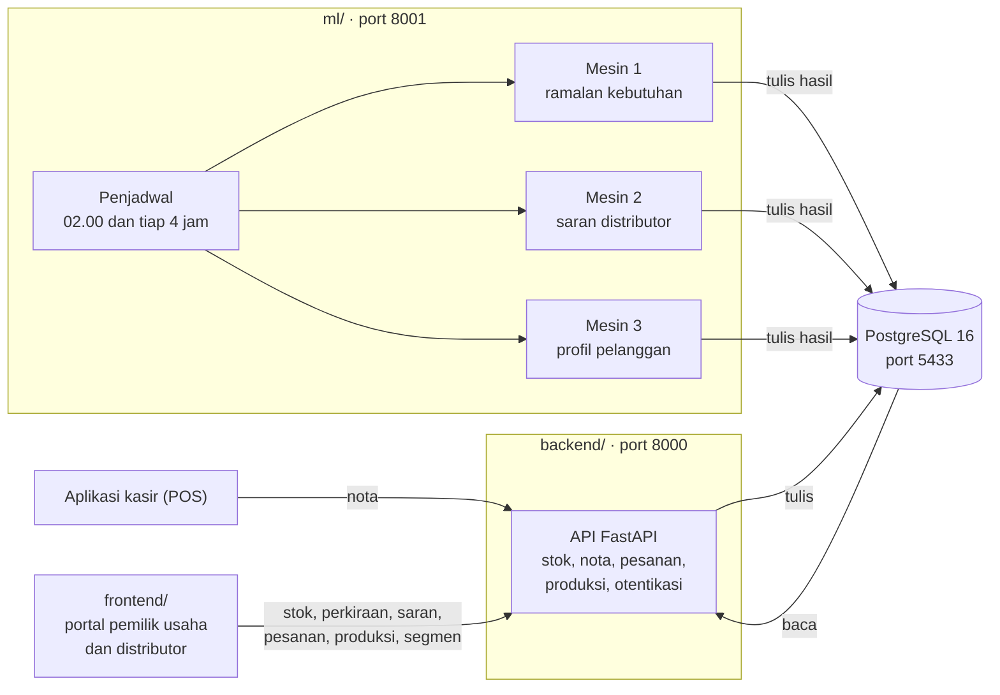
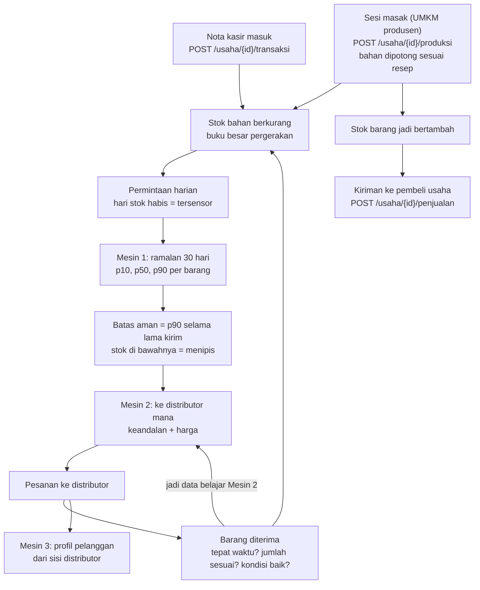

<p align="center">
  
</p>

# Turnify Flow

Sistem analitika rantai pasok untuk UMKM sebagai pendamping aplikasi kasir.
Turnify Flow tidak menggantikan kasir yang sudah dipakai warung. Ia membaca nota
dari kasir, menghitung sisa stok gudang, meramal kebutuhan pekan dan bulan
berikutnya, lalu menyarankan ke distributor mana sebaiknya memesan. UMKM yang
memproduksi sendiri (misalnya sambal rumahan yang dijual ke ritel) mencatat sesi
masak dan kirimannya di aplikasi yang sama.

Project Analitika Data, Program Studi Sains Data Terapan, Politeknik Elektronika
Negeri Surabaya. Dosen pengampu: Dr. Edi Satriyanto, S.Si., M.Si.
Tim: Kadek Savita Dyutianaya, Ilham Bintang Satria, Raja Rahman Aziiz, Lailatul Maghfiroh.

**Baru pertama kali di sini?** Langsung ke [Mulai cepat](#mulai-cepat), lalu
[Akun simulasi](#akun-simulasi) untuk masuk ke aplikasi. Kalau ada yang macet,
lihat [Kalau ada yang tidak jalan](#kalau-ada-yang-tidak-jalan).

---

## Daftar isi

1. [Mulai cepat](#mulai-cepat)
2. [Akun simulasi](#akun-simulasi)
3. [Kalau ada yang tidak jalan](#kalau-ada-yang-tidak-jalan)
4. [Arsitektur](#arsitektur)
5. [Tiga mesin analitik](#tiga-mesin-analitik)
6. [Struktur proyek](#struktur-proyek)
7. [Endpoint](#endpoint)
8. [Image Docker](#image-docker)
9. [Yang belum selesai](#yang-belum-selesai)
10. [Dokumentasi lain](#dokumentasi-lain)

---

## Mulai cepat

Semua perintah untuk **Windows PowerShell** dan dijalankan dari **akar repo**.

> Pakai branch **`Rombak#4`**. Branch `main` hanya berisi purwarupa antarmuka
> lama, tanpa backend dan model.

### Paling mudah untuk mencoba: `siapkan.cmd`

Untuk yang hanya ingin melihat aplikasinya jalan, tanpa Python dan tanpa perlu
mengerti Docker:

1. Buka [halaman `siapkan.cmd` di GitHub](https://github.com/YonoBengkel/Warungku/blob/Rombak%234/siapkan.cmd),
   tekan tombol **Download raw file**, lalu taruh berkasnya di folder mana saja
   (misalnya `Documents`). Belum perlu clone apa pun.
2. Klik dua kali `siapkan.cmd`, lalu tunggu sampai peramban terbuka.

Yang dikerjakan skrip itu:
- memeriksa Git, Docker Desktop, dan Node.js; yang belum ada ditawarkan untuk
  dipasang lewat winget (selalu ditanya dulu);
- clone repo (branch `Rombak#4`) ke folder `turnify-flow` di sebelah berkas itu;
- menyalakan Docker Desktop, mengunduh image dari Docker Hub (sekitar 400 MB
  pertama kali), lalu menyalakan kontainer basis data, API, dan layanan model;
- menyiapkan `deployment/.env` dengan rahasia login acak;
- merapikan deskripsi kemasan barang dan memasang variasi demo untuk akun Kopi
  Kita dan Bu Ratmi (pesanan di setiap tahap, kontrak, stok habis dan menipis, resep
  dan menu kasir yang belum dipasangkan),
  bertanggal hari ini dan disegarkan kalau umurnya lebih dari tiga hari;
- memasang paket frontend dan menyalakannya di jendela yang diperkecil ke taskbar;
- membuka peramban di halaman Masuk.

Hari berikutnya, klik dua kali `siapkan.cmd` **di dalam folder `turnify-flow`**
untuk menyalakan lagi; kodenya sekalian diperbarui kalau tidak ada perubahan
yang belum dikomit. Selesai memakai, klik dua kali `matikan.cmd` di folder yang
sama. Datanya tetap tersimpan.

- **Docker Desktop yang baru dipasang** butuh komputer dinyalakan ulang dan layar
  sambutannya dibuka sekali. Skrip berhenti dan memberi tahu kapan harus
  menjalankannya lagi.
- **Fitur yang tampil mengikuti image Docker**, bukan kode terbaru di branch
  (lihat [Image yang diunduh](#image-yang-diunduh)).
- **`siapkan.cmd` dan `nyalakan.cmd` memakai port yang sama.** Kalau sebelumnya
  memakai yang satu, jalankan `matikan.cmd` dulu sebelum memakai yang lain.

### Yang harus terpasang

| Kebutuhan | Versi | Cara memastikan | Dibutuhkan jalur |
| --- | --- | --- | --- |
| Git | — | `git --version` | A dan B |
| Docker Desktop | yang terbaru | `docker --version` | A dan B |
| Node.js | 18+ (diuji pada 24) | `node --version` | A dan B |
| Python | **3.12 atau lebih baru** (diuji pada 3.14) | `python --version` | B saja |

### 1. Ambil kodenya

```powershell
git clone https://github.com/YonoBengkel/Warungku.git turnify-flow
cd turnify-flow
git switch "Rombak#4"
```

Sudah pernah clone? Cukup ambil perubahan terbaru:

```powershell
git switch "Rombak#4"
git pull
```

### Paling mudah di Windows: `nyalakan.cmd`

Klik dua kali **`nyalakan.cmd`** di akar repo. Semua langkah jalur B di bawah
dikerjakan sekaligus:
- Docker Desktop dan basis data dinyalakan;
- paket Python dan frontend dipasang bila belum ada;
- `backend\.env` disiapkan, termasuk rahasia login acak;
- skema dinaikkan dan UMKM produsen ditambahkan bila belum ada;
- variasi demo untuk kedua akun simulasi disegarkan bila umurnya lebih dari tiga
  hari (lihat [Akun simulasi](#akun-simulasi));
- API, layanan model, dan frontend dibuka di tiga jendela;
- ketiga mesin dijalankan bila keluarannya belum lengkap;
- peramban dibuka di halaman Masuk.

Menjalankannya lagi aman: layanan yang sudah menyala dipakai apa adanya.

Selesai memakai? Klik dua kali **`matikan.cmd`**. Datanya tetap tersimpan di
basis data. `matikan.cmd` juga menghentikan kontainer API dan layanan model dari
`siapkan.cmd`. Isi dan pilihan kedua skrip ada di [`tools/lokal/`](tools/lokal/).

Yang dibutuhkan hanya Git, Docker Desktop, Node.js, dan Python (tabel di atas).
Saat pertama kali, image basis data `yonobengkel/turnify-flow-db` diunduh otomatis
dari Docker Hub (lihat [Image yang diunduh](#image-yang-diunduh)). Kalau ada langkah
yang gagal, skrip berhenti dan menyebut penyebabnya.

### 2. Pilih jalur (kalau ingin menjalankan sendiri)

| | Jalur A: hanya mencoba | Jalur B: mengembangkan |
| --- | --- | --- |
| Untuk siapa | Yang ingin melihat aplikasinya jalan | Yang mengubah kode backend, model, atau data |
| Butuh Python | Tidak | Ya |
| API dan layanan model | Kontainer Docker | `uvicorn` di komputermu |
| Fitur terbaru | Mengikuti versi image Docker (lihat catatan di bawah) | Selalu sama dengan kode di branch |

### Jalur A: hanya mencoba (tanpa Python)

`siapkan.cmd` (lihat di atas) mengerjakan jalur ini sekaligus. Langkah manualnya:

```powershell
docker compose -f deployment/docker-compose.yml --profile layanan up -d
npm install
npm run dev
```

Buka http://localhost:5173, lalu masuk dengan [akun simulasi](#akun-simulasi).

- **Perintah pertama** menyalakan basis data (port 5433), API (port 8000), dan
  layanan model (port 8001) dari image Docker Hub, yang diunduh otomatis. Image
  dan tag mana yang dipakai ada di [Image yang diunduh](#image-yang-diunduh). Saat pertama kali, basis data
  memulihkan data simulasi sekitar satu menit; tunggu sampai
  `docker ps` menunjukkan `warungku-db` berstatus `healthy`.
- **`npm install` dan `npm run dev`** di akar repo diteruskan ke `frontend/`.
- **Mematikan:** `docker compose -f deployment/docker-compose.yml --profile layanan stop`.

> **Pernah menjalankan jalur A sebelum 16 Oktober 2026?** Basis data hanya
> dipulihkan dari image ke volume yang masih kosong, jadi volume lamamu tetap
> berisi data versi lama (tanpa tabel produksi dan tanpa UMKM produsen). Pilih
> salah satu:
> - Ganti dengan data baru dari image (data lama di volume **hilang**):
>   `docker compose -f deployment/docker-compose.yml --profile layanan down -v`,
>   lalu jalankan lagi perintah jalur A di atas.
> - Pertahankan data lama: pakai `nyalakan.cmd` (butuh Python), yang menaikkan
>   skema dan menambahkan UMKM produsen ke basis datamu.

### Jalur B: mengembangkan

**B1. Basis data saja** dari Docker:

```powershell
docker compose -f deployment/docker-compose.yml up -d
```

PostgreSQL berjalan di port **5433**, bukan 5432, supaya tidak bentrok dengan
PostgreSQL yang mungkin sudah ada di komputermu. Image-nya sudah berisi data
simulasi.

**B2. Lingkungan Python dan skema terbaru:**

```powershell
python -m pip install -r requirements.txt
python -m pip install -e . --no-deps
copy backend\.env.example backend\.env
python -m alembic -c backend/alembic.ini upgrade head
```

- **`pip install -e .`** membuat paket `api`, `warungku`, `ml`, dan `dataset`
  bisa diimpor dari mana pun, walau foldernya terpisah.
- **`alembic upgrade head`** wajib dijalankan setiap kali menarik kode baru. Ia
  menambahkan tabel yang belum ada di basis data, misalnya tabel produksi.
- **Isi `WARUNGKU_RAHASIA`** di `backend/.env` dengan teks acak yang panjang. Tanpanya
  API membuat rahasia baru setiap kali dinyalakan, dan semua orang harus masuk ulang.

**B3. Lengkapi data** bila basis datamu berasal dari image lama `turnify-flow-db:0.1.0`
(belum ada UMKM produsen). Volume yang dipulihkan dari `0.2.0` sudah lengkap:

```powershell
python -m dataset.umkm_produksi
```

Perintah ini hanya **menambah** Dapur Sambal Bu Ratmi beserta riwayat 400 harinya.
70 UMKM lain tidak berubah. Kalau usahanya sudah ada, perintah ini berhenti
tanpa mengubah apa pun.

**B4. Jalankan.** Masing-masing di terminal sendiri:

```powershell
python -m uvicorn api.utama:app --port 8000
```

```powershell
python -m uvicorn ml.layanan:app --port 8001
```

```powershell
npm install
npm run dev
```

**B5. Isi keluaran ketiga mesin** sekali sesudah data berubah (sesudah itu
penjadwal di layanan model yang menjalankannya):

```powershell
curl.exe -X POST localhost:8001/mesin1/jalankan -H "Content-Type: application/json" -d "{}"
curl.exe -X POST localhost:8001/mesin2/jalankan -H "Content-Type: application/json" -d "{}"
curl.exe -X POST localhost:8001/mesin3/jalankan
```

Mesin 1 untuk semua barang butuh sekitar tiga setengah menit, termasuk uji balik
bulanan untuk garis perkiraan masa lalu di grafik bulanan.

> Tulis `curl.exe`, bukan `curl`. Di PowerShell, `curl` adalah alias
> `Invoke-WebRequest` yang tidak mengenal `-X`.

| Alamat | Isi |
| --- | --- |
| http://localhost:5173 | Portal pemilik usaha dan portal distributor |
| http://localhost:8000/docs | Dokumentasi API interaktif |
| http://localhost:8001/docs | Dokumentasi layanan model |

**B6. Uji otomatis:**

```powershell
python -m pytest -q
```

Menjalankan `backend/uji` dan `ml/uji` (115 uji). Sebagian uji membutuhkan basis
data dari langkah B1 sampai B3. Uji backend membuat dan menghapus datanya sendiri,
jadi tidak mengubah data simulasi.

### Membangkitkan ulang dataset simulasi (opsional)

Tidak perlu untuk mencoba aplikasi: image basis data sudah berisi datanya.

```powershell
python -m dataset.buat_dataset
```

Sekitar 10 menit. Perintah ini **mengosongkan lalu mengisi ulang** basis data,
termasuk keluaran model (`prediksi`, `rekomendasi_skor`, `segmen_pelanggan`), lalu
menambahkan UMKM produsen di akhir. Jalankan ketiga mesin lagi sesudahnya (B5).
Untuk membangkitkan ulang UMKM produsen saja:

```powershell
python -m dataset.umkm_produksi --ulang
```

Periksa datanya konsisten (ketujuh angkanya harus 0):

```powershell
Get-Content backend\skrip\02_periksa_konsistensi.sql | docker exec -i warungku-db psql -U warungku -d warungku_dev
```

### Opsional lain

- **MOIRAI sebagai pembanding Mesin 1** butuh lingkungan terpisah (Python 3.12,
  `ml/requirements-ml.txt`), karena `uni2ts` memaku versi scipy yang tidak punya
  wheel untuk Python 3.14. Lisensi bobotnya CC-BY-NC-4.0 (non-komersial).
- **Chronos-2** (pembanding Mesin 1) mengunduh bobotnya dari HuggingFace saat
  pertama dipakai, jadi perlu internet sekali.
- **Data toko roti sungguhan** untuk validasi Mesin 1: cara mengunduhnya di
  [`data/data_nyata/french_bakery/README.md`](data/data_nyata/french_bakery/README.md).
- **Laporan progres untuk dosen** (Word dan PDF) dibangun ulang dari berkas hasil
  dan basis data: `python docs/laporan/bangun_laporan_dosen.py`.
- **Gambar produk dan logo toko** (ilustrasi SVG) dibangkitkan ulang dengan
  `python tools/buat_gambar.py`. Ganti berkas di `frontend/public/gambar/` dengan
  foto sungguhan kapan saja; nama berkasnya tetap.
- **API di alamat lain:** isi `VITE_API_URL` (bawaan `http://localhost:8000`)
  sebelum `npm run dev`.

---

## Akun simulasi

Tanpa masuk, portal memakai **data contoh** di memori peramban: semua layar bisa
dilihat, tetapi angkanya karangan. Untuk melihat data simulasi dan keluaran
ketiga mesin, masuk dengan salah satu akun berikut. API (port 8000) harus menyala.

| Akun | Portal | Usaha | Yang bisa dicoba |
| --- | --- | --- | --- |
| `umkm1@warungku.test` | Pemilik usaha | Kopi Kita Jogja (kedai kopi) | Stok, grafik pemakaian aktual vs perkiraan, Prediksi, saran distributor, belanja, pesanan, kontrak, promo |
| `produksi1@warungku.test` | Pemilik usaha produsen | Dapur Sambal Bu Ratmi | Semua yang di atas, ditambah tab **Produksi**: resep, catat sesi masak, kiriman ke Indomaret, swalayan, toko oleh-oleh, dan katering |
| `distributor1@warungku.test` | Distributor | Sumber Tani Nusantara | Pesanan masuk, kontrak dan paket, promo, segmen pelanggan (Mesin 3) |

**Cara masuk tanpa mengetik:**

- **Pemilik usaha:** halaman *Masuk* → tab *Pakai Email* → tekan *Isikan akun
  simulasi: Kopi Kita Jogja* atau *Isikan akun simulasi produsen: Dapur Sambal Bu
  Ratmi* → *Masuk*.
- **Distributor:** halaman *Masuk* → *Masuk ke portal distributor* → *Isikan akun
  simulasi* → *Masuk*.

**Akun lain:** ada juga `umkm2` sampai `umkm70` dan `distributor2` sampai
`distributor8` (semua `@warungku.test`). Kata sandi semua akun simulasi adalah
`KATA_SANDI_CONTOH` di [`data/dataset/buat_dataset.py`](data/dataset/buat_dataset.py).
Ini akun uji untuk data buatan tim, bukan akun sungguhan.

**Variasi demo.** Supaya setiap penyaring punya isi, `umkm1` dan `produksi1` diberi
pesanan yang masih berjalan (menunggu konfirmasi, disiapkan, dikirim, sudah sampai)
dan yang dibatalkan, kontrak dengan beberapa distributor (berjalan, akan berakhir,
menunggu persetujuan, selesai, dihentikan atau ditolak), serta stok yang mengisi
setiap penyaring di halaman Stok: habis, menipis, perlu dibeli, segera kedaluwarsa,
masih batas bawaan, dan tidak bergerak (barang yang dibeli tapi belum terpakai). Tanggal pesanan dan kontraknya relatif terhadap hari ini, jadi
`nyalakan.cmd` menyegarkannya bila umurnya lebih dari tiga hari. Memasangnya ulang
dengan tangan (mengembalikan pesanan dan kontrak demo ke keadaan awal):
`python -m dataset.variasi_demo`. Rinciannya di
[`data/dataset/variasi_demo.py`](data/dataset/variasi_demo.py).

**Tanggal data.** Data simulasi berjalan 400 hari dan berhenti pada **5 Oktober
2026**. Grafik menulis "data terakhir", bukan "hari ini". Mencatat kiriman baru
membuat jendela 28 hari ikut maju ke hari-hari tanpa data, sehingga perkiraan
pesanan pekan depan di tab Produksi turun.

---

## Kalau ada yang tidak jalan

| Gejala | Penyebab paling mungkin | Yang perlu dilakukan |
| --- | --- | --- |
| Tombol *Masuk* dengan akun simulasi gagal, atau angka di layar tetap data contoh | API (port 8000) belum menyala, atau basis data mati | Cek `curl.exe localhost:8000/sehat`. Nyalakan `uvicorn` (B4) atau kontainer (jalur A) |
| Halaman *Pelanggan* di portal distributor kosong | Layanan model belum pernah menjalankan Mesin 3 | Jalankan perintah B5 |
| Grafik perkiraan atau saran distributor kosong untuk satu barang | Mesin 1 atau 2 belum dijalankan sesudah data berubah | Jalankan perintah B5 |
| Harus masuk ulang setiap API dinyalakan ulang | `WARUNGKU_RAHASIA` kosong | Isi di `backend/.env` (jalur B) atau `deployment/.env` (jalur A) |
| `produksi1@warungku.test` tidak bisa masuk | Basis data belum memuat UMKM produsen | Jalankan B2 (`alembic upgrade head`) lalu B3, kemudian B5 |
| Galat tentang tabel `produk_jadi` atau `produksi`, atau tab Produksi kosong | Volume basis data masih dari versi lama, skemanya tertinggal dari kode | Jalur B atau `nyalakan.cmd`: `python -m alembic -c backend/alembic.ini upgrade head`. Jalur A: lihat kotak "Pernah menjalankan jalur A sebelum 16 Oktober 2026?" |
| Basis data menyala tetapi kosong | Volume lama dari versi sebelum data ikut di image | `docker compose -f deployment/docker-compose.yml down -v`, lalu nyalakan lagi. **Ini menghapus isi basis data**; jangan dijalankan kalau ada data yang ingin disimpan |
| Port 5433, 8000, atau 8001 sudah dipakai | Kontainer dan `uvicorn` dinyalakan bersamaan, atau layanan lain memakai port itu | Pilih satu: jalur A atau `uvicorn`. Hentikan yang lain |
| `curl -X ...` gagal di PowerShell | `curl` adalah alias `Invoke-WebRequest` | Tulis `curl.exe` |

---

## Arsitektur



Satu aturan memisahkan `api` dan `ml`: **layanan model menulis ke tabel, API membaca
tabel.** API tidak pernah memanggil model saat halaman dibuka. Kalau layanan model
mati, portal tetap terbuka dengan angka terakhir yang tersimpan, dan kolom
`tingkat_layanan` menyatakan bahwa angkanya tidak segar.

### Alur data, dari nota sampai pesanan



Bahan baku yang terpakai produksi dicatat sama seperti bahan yang laku di warung,
jadi Mesin 1 meramal kebutuhan bahan baku UMKM produsen tanpa perlakuan khusus.

---

## Tiga mesin analitik

| Mesin | Pertanyaan yang dijawab | Model produksi | Pembanding | Hasil terkini |
| --- | --- | --- | --- | --- |
| **1** | Berapa banyak dan kapan harus memesan? | LightGBM kuantil (p10, p50, p90), satu model global untuk semua barang. Masukan: lag 7–28 hari, rata-rata 7 dan 28 hari, hari dalam pekan, kalender libur, pekan gajian, Ramadan | SARIMA(1,0,1)(0,1,1)₇ (model produksi sampai 16 Okt 2026), ETS/Holt-Winters, Chronos-2, naif musiman | Pekan uji, semua barang: MAPE pekanan 23,0% (SARIMA 23,4%), cakupan rentang p10–p90 81,6% (sasaran 80%). Pada barang yang lolos saringan turnamen keduanya 14,8%. Omset: SARIMAX 9,4% di simulasi, Chronos-2 4,0% di toko roti sungguhan |
| **2** | Ke distributor mana sebaiknya memesan barang ini? | Beta-Bernoulli + Thompson sampling + fuzzy Sugeno (keandalan × harga) | TOPSIS, BART, regresi logistik Bayesian, LinUCB | Regret 1.465 ± 26 (10 benih) vs TOPSIS 1.551. "Selalu termurah" lebih buruk daripada memilih acak |
| **3** | Pelanggan mana yang andal, mana yang mulai menjauh? (untuk distributor) | K-Prototypes atas RFM (frequency dan monetary di-log), jenis usaha, kategori | Gower + aglomeratif, Gower + HDBSCAN | Stabilitas segmen 0,913 (ARI subsampel 80%) |

Nama metode setiap mesin juga tertulis di aplikasi: di halaman Prediksi (Mesin 1),
kartu saran distributor dan bagian "Rekomendasi untuk usahamu" di halaman
Distributor (Mesin 2), dan halaman Pelanggan portal distributor (Mesin 3). Di
halaman Distributor, skor Mesin 2 tiap barang yang perlu dibeli dirata-rata per
distributor; distributor yang belum dinilai menyusul dengan urutan ulasan dan harga.

Semua angka di atas berasal dari berkas di [`ml/hasil/`](ml/hasil/), misalnya
[`hasil_eksperimen_mesin1_lgbm.json`](ml/hasil/hasil_eksperimen_mesin1_lgbm.json)
untuk perbandingan LightGBM dan SARIMA. Setiap perubahan model dicatat di sheet
*Model Warungku → Catatan Perubahan*. Rincian dan batas penafsirannya ada di
[`docs/laporan/`](docs/laporan/) dan [`ml/eksperimen/README.md`](ml/eksperimen/README.md).

> **Batas penting saat membaca angka.** Data warung berasal dari simulasi 400 hari
> dengan 70 UMKM dan satu UMKM produsen yang kami rancang sendiri, termasuk
> keputusan membuat distributor termurah menjadi yang terburuk. Metode Mesin 1 juga
> diuji pada data toko roti sungguhan (French Bakery), tetapi belum pada warung
> Indonesia sungguhan.

---

## Struktur proyek

```
turnify-flow/
├── frontend/      # React + Vite: portal pemilik usaha dan portal distributor
├── backend/       # FastAPI: API, model tabel, migrasi basis data, uji
├── ml/            # Mesin 1, 2, 3, layanan model, percobaan, dan hasilnya
├── data/          # Pembangkit dataset simulasi dan data nyata pihak luar
├── docs/          # Laporan, dokumen proses bisnis, desain, aset, arsip
├── deployment/    # docker-compose (PostgreSQL, API, layanan model) dan Dockerfile backend
├── tools/         # Pembangkit gambar produk dan logo, penangkap layar
├── pyproject.toml # Satu proyek Python untuk backend, ml, dan data
├── requirements.txt           # Lingkungan lengkap: produksi + eksperimen (Chronos, PyMC)
└── requirements-produksi.txt  # Hanya yang dipakai model produksi; dipakai image Docker
```

| Folder | Isi |
| --- | --- |
| `frontend/src/` | Halaman (`pages/`), komponen, kerangka, store Zustand, klien API (`lib/api*.ts`), dan data contoh (`data/dummy.ts`) |
| `frontend/public/gambar/` | Ilustrasi produk dan logo toko (SVG), dibangkitkan `tools/buat_gambar.py` |
| `backend/api/` | Endpoint REST. Hanya membaca keluaran model, tidak pernah memanggilnya |
| `backend/warungku/` | Model tabel (SQLModel), enum, koneksi. Nama paketnya belum diganti |
| `backend/migrations/` | Migrasi Alembic |
| `backend/skrip/` | SQL pemeliharaan dan pemeriksaan konsistensi |
| `ml/mesin1/`, `mesin2/`, `mesin3/` | Kode ketiga mesin. Model produksi dipanggil dari `ml/layanan.py` |
| `ml/sumber/` | Satu pintu data untuk model: simulasi dan data nyata dengan bentuk yang sama |
| `ml/eksperimen/` | Percobaan penyetelan yang tidak mengubah kode produksi |
| `ml/hasil/` | Ringkasan hasil percobaan (`hasil_*.json`, dilacak git) |
| `data/dataset/` | Pembangkit dataset simulasi (`buat_dataset.py`) dan UMKM produsen (`umkm_produksi.py`) |
| `data/data_nyata/` | Data nyata pihak luar; berkas CSV tidak dilacak karena lisensinya |
| `docs/laporan/` | Laporan Word/PDF dan pembangkitnya; angkanya dibaca dari `ml/hasil/` dan basis data |
| `deployment/` | `docker-compose.yml`, `Dockerfile` image backend, dan `db/` untuk image basis data |

---

## Endpoint

### API utama (port 8000)

| Method | Endpoint | Keterangan |
| --- | --- | --- |
| POST | `/auth/umkm/daftar` | Buat akun pemilik usaha beserta usahanya (satu akun, satu usaha) |
| POST | `/auth/umkm/masuk` | Masuk sebagai pemilik usaha |
| POST | `/auth/distributor/masuk` | Masuk sebagai distributor |
| GET | `/auth/saya` | Siapa pemegang token ini |
| GET | `/usaha/{usaha_id}/barang` | Daftar barang di gudang, termasuk pemakaian rata-rata 28 hari, harga per satuan, dan hari sejak terakhir terpakai (`hari_tanpa_pemakaian`, dihitung dari hari terakhir data) |
| GET | `/usaha/{usaha_id}/barang/{barang_id}/perkiraan` | Perkiraan terbaru Mesin 1 (p10, p50, p90 per hari), termasuk uji balik 14 hari (`uji_balik`) |
| GET | `/usaha/{usaha_id}/barang/{barang_id}/riwayat` | Pemakaian harian terakhir; hari stok habis ditandai |
| GET | `/usaha/{usaha_id}/barang/{barang_id}/saran` | Saran distributor terbaru Mesin 2, dibaca dari tabel |
| GET | `/usaha/{usaha_id}/saran-distributor` | Saran Mesin 2 dirangkum per distributor: rata-rata skor, peluang lancar, barang yang menempatkannya di urutan pertama |
| GET | `/usaha/{usaha_id}/pemakaian-bulanan` | Pemakaian per 30 hari beserta uji balik Mesin 1 tiap periode (`uji_balik`), dan perkiraan 30 hari ke depan, semua barang |
| POST | `/usaha/{usaha_id}/transaksi` | Terima satu nota kasir; aman dikirim ulang. Tiap menu memotong bahan sesuai resepnya; stok yang kurang dipotong sampai nol dan dilaporkan di `stok_kurang` |
| GET | `/usaha/{usaha_id}/transaksi?batas=` | Nota terbaru beserta barisnya |
| GET, PUT | `/usaha/{usaha_id}/menu-kasir` | Menu dari nota yang belum punya bahan, resep yang sudah ada, nota terakhir dan jumlah hari ini; simpan resep satu menu (hanya berlaku untuk nota berikutnya) |
| GET | `/usaha/{usaha_id}/produksi/ringkasan` | UMKM produsen: barang jadi, resep, jumlah yang bisa dibuat, perkiraan pesanan 7 hari, saran masak, pembeli, omset bulanan |
| GET, POST | `/usaha/{usaha_id}/produksi` | Riwayat sesi masak; catat sesi masak (bahan dipotong sesuai resep, ditolak kalau bahan kurang) |
| GET, POST | `/usaha/{usaha_id}/penjualan` | Riwayat kiriman ke pembeli usaha; catat kiriman (ditolak kalau stok barang jadi kurang) |
| GET | `/usaha/{usaha_id}/ringkasan-penjualan?dari=&sampai=` | Ringkasan penjualan: dari nota kasir, atau dari kiriman ke pembeli untuk UMKM produsen. Total, jumlah, per hari, terlaris, pembanding periode sebelumnya; tanpa nota demo. Rentang bawaan 30 hari sampai data terakhir |
| GET | `/usaha/{usaha_id}/pesanan` | Pesanan usaha ini beserta baris dan jejaknya |
| POST | `/usaha/{usaha_id}/pesanan` | Kirim keranjang; satu pesanan per distributor, harga disalin saat itu |
| GET | `/usaha/{usaha_id}/pesanan/{pesanan_id}` | Rincian satu pesanan |
| POST | `/usaha/{usaha_id}/pesanan/{pesanan_id}/batal` | Batalkan pesanan yang belum dijawab distributor |
| POST | `/usaha/{usaha_id}/pesanan/{pesanan_id}/terima` | Hitung barang yang datang: stok naik, data latih Mesin 2 tertulis |
| GET | `/usaha/{usaha_id}/katalog` | Distributor (rating dari ulasan), penawaran, paket kontrak, dan promo |
| GET | `/usaha/{usaha_id}/distributor/{distributor_id}/ulasan` | Ulasan terbaru satu distributor |
| GET | `/usaha/{usaha_id}/kontrak` | Kontrak usaha ini beserta kuota per bulan |
| POST | `/usaha/{usaha_id}/kontrak` | Ajukan kontrak dari satu paket; harga dan kuota disalin saat itu |
| POST | `/usaha/{usaha_id}/kontrak/{kontrak_id}/berhenti` | Ajukan berhenti; kontrak tetap jalan sampai dijawab |
| POST | `/usaha/{usaha_id}/kontrak/{kontrak_id}/rutin` | Pesanan rutin hidup atau mati |
| GET | `/distributor/{distributor_id}/pesanan` | Ringkasan pesanan yang masuk, terbaru dulu |
| GET | `/distributor/{distributor_id}/pesanan-masuk` | Pesanan masuk lengkap dengan baris, jejak, dan profil pemesan |
| GET | `/distributor/{distributor_id}/pesanan/{pesanan_id}` | Rincian satu pesanan masuk |
| POST | `/distributor/{distributor_id}/pesanan/{pesanan_id}/konfirmasi` | Terima pesanan; status menjadi disiapkan |
| POST | `/distributor/{distributor_id}/pesanan/{pesanan_id}/tolak` | Tolak dengan alasan; status menjadi batal |
| POST | `/distributor/{distributor_id}/pesanan/{pesanan_id}/kirim` | Barang berangkat; status menjadi dikirim |
| POST | `/distributor/{distributor_id}/pesanan/{pesanan_id}/sampai` | Bukti antar; stok baru naik setelah pemilik usaha menerima |
| GET | `/distributor/{distributor_id}/katalog` | Penawaran, paket kontrak, dan promo milik sendiri |
| GET | `/distributor/{distributor_id}/profil` | Profil distributor sendiri, termasuk titik gudang |
| PUT | `/distributor/{distributor_id}/lokasi` | Simpan titik gudang untuk peta Lacak Pesanan (kosongkan keduanya untuk kembali ke titik tengah kota) |
| GET | `/distributor/{distributor_id}/ringkasan-penjualan?dari=&sampai=` | Ringkasan penjualan dari pesanan selesai: pendapatan (nilai barang + ongkos kirim), pesanan, pelanggan, terlaris; tanpa pesanan variasi demo |
| POST, PUT, DELETE | `/distributor/{distributor_id}/paket[/{paket_id}]` | Kelola paket kontrak; kontrak berjalan tidak ikut berubah |
| GET | `/distributor/{distributor_id}/kontrak` | Kontrak pelanggan |
| POST | `/distributor/{distributor_id}/kontrak/{kontrak_id}/setujui` | Masa kontrak dihitung sejak disetujui |
| POST | `/distributor/{distributor_id}/kontrak/{kontrak_id}/tolak` | Tolak pengajuan, wajib beralasan |
| POST | `/distributor/{distributor_id}/kontrak/{kontrak_id}/jawab-berhenti` | Setujui atau tolak (beralasan) permintaan berhenti |
| POST, PUT | `/distributor/{distributor_id}/promo[/{promo_id}]` | Buat atau ubah promo; potongannya masuk ke harga beli sekali |
| POST | `/distributor/{distributor_id}/promo/{promo_id}/akhiri` | Akhiri promo; pesanan lama tetap memakai harga potongannya |
| GET | `/distributor/{distributor_id}/segmen` | Ringkasan segmen pelanggan (Mesin 3) |
| GET | `/distributor/{distributor_id}/segmen/{segmen}` | Anggota satu segmen beserta angka RFM-nya |
| GET | `/sehat` | Keadaan layanan dan basis data |

Token pemilik usaha dan token distributor berbeda jenis: portal distributor tidak
bisa dibuka dengan token pemilik usaha, walau alamatnya ditebak. Urutan status
pesanan dijaga server: langkah yang dilompati ditolak dengan 409.

### Layanan model (port 8001)

| Method | Endpoint | Keterangan |
| --- | --- | --- |
| POST | `/mesin1/jalankan` | Jalankan Mesin 1, tulis ke `prediksi` (memblokir): perkiraan 30 hari, uji balik 14 hari, dan uji balik bulanan. Bawaan `{"metode": "lightgbm"}`; `"sarima"` juga bisa; `{"uji_bulanan": false}` melewati uji balik bulanan |
| POST | `/mesin1/jadwalkan` | Sama, di latar; jalur yang dipakai penjadwal |
| POST | `/mesin2/jalankan` | Nilai kandidat distributor, tulis ke `rekomendasi_skor` |
| POST | `/mesin3/jalankan` | Segmentasi pelanggan tiap distributor, tulis ke `segmen_pelanggan` |
| GET | `/jadwal` | Apa yang dijadwalkan, kapan berikutnya, hasil terakhirnya |
| GET | `/sehat` | Keadaan basis data dan jumlah baris keluaran tiap mesin |

Penjadwal hidup di dalam layanan model: Mesin 1 setiap hari pukul 02.00 WIB,
Mesin 2 dan 3 setiap empat jam. Matikan dengan `WARUNGKU_JADWAL=0` kalau
dijadwalkan dari luar. Metode Mesin 1 yang dipakai penjadwal diatur lewat
`WARUNGKU_METODE_MESIN1` (bawaan `lightgbm`).

---

## Image Docker

### Image yang diunduh

Ada dua image di Docker Hub, keduanya publik (tidak perlu `docker login` untuk
mengunduh). **Unduh tag yang tertulis di tabel ini**: tag inilah yang dipakai
[`deployment/docker-compose.yml`](deployment/docker-compose.yml). Tag yang lebih
lama jangan dipakai: backend `0.8.0` belum punya resep menu kasir (`/menu-kasir`), dan nota
kasirnya gagal seluruhnya kalau satu bahan stoknya habis; backend `0.7.0` masih menulis angka gaya Inggris di alasan Mesin 2
("2029 pesanan", "4.8 dari 5") dan di pesan galat Produksi, backend `0.6.0` belum punya
`/saran-distributor`, sehingga
"Rekomendasi untuk usahamu" di halaman Distributor belum diurutkan Mesin 2,
backend `0.5.0` menganggap semua barang "tidak bergerak" di halaman Stok, backend `0.4.0` belum menggambar garis perkiraan masa lalu di grafik
bulanan, dan backend `0.3.0` ke bawah serta basis data `0.1.0` belum memuat
perubahan 16 Oktober 2026 (Mesin 1 LightGBM, UMKM produsen, gambar produk).
Backend `0.9.0` membutuhkan basis data `0.2.0`, karena tabel produksinya baru ada di
sana. Saat pertama menyala di atas basis data `0.2.0`, layanan model menjalankan
Mesin 1 sekali (sekitar 4 menit) untuk mengisi uji balik bulanan.

| Image | Tag yang dipakai | Isi | Halaman Docker Hub |
| --- | --- | --- | --- |
| `yonobengkel/turnify-flow-db` | **`0.2.0`** | PostgreSQL 16 yang memulihkan data simulasi (70 UMKM, 1 UMKM produsen, 8 distributor, 400 hari) beserta keluaran ketiga mesin saat pertama kali dinyalakan | https://hub.docker.com/r/yonobengkel/turnify-flow-db/tags |
| `yonobengkel/turnify-flow-backend` | **`0.9.0`** | Satu image untuk API (port 8000) dan layanan model (port 8001). Isinya hanya model produksi (LightGBM, Beta-Bernoulli + fuzzy, K-Prototypes), lihat [`requirements-produksi.txt`](requirements-produksi.txt); tanpa Chronos atau PyMC | https://hub.docker.com/r/yonobengkel/turnify-flow-backend/tags |

**Tidak perlu mengunduh dengan tangan.** Perintah `docker compose ... up -d` di
jalur A dan B, juga `nyalakan.cmd`, mengunduh image yang dibutuhkan secara
otomatis. Kalau ingin mengunduh lebih dulu (misalnya sebelum ke kampus dengan
internet lambat):

```powershell
docker pull yonobengkel/turnify-flow-db:0.2.0
docker pull yonobengkel/turnify-flow-backend:0.9.0
```

`nyalakan.cmd` dan jalur B hanya memakai image basis data. Image backend hanya
dipakai jalur A.

Hal yang perlu diketahui:

- **Data hanya dipulihkan ke volume yang belum pernah dipakai.** Kalau sebelumnya
  pernah menyalakan basis data versi lama, data di volume itu tetap dipakai.
- **Penjadwal ikut menyala** di kontainer `turnify-ml` dan menulis hasilnya ke
  basis data.
- **Rahasia tidak ada di dalam image.** Isi `WARUNGKU_RAHASIA` di `deployment/.env`
  (berkas ini tidak dilacak git) supaya login tidak hangus setiap kontainer
  dinyalakan ulang.
- **Cadangan basis data tidak dilacak git.** Isinya data simulasi buatan tim,
  termasuk akun uji yang kata sandinya terbuka di kode; tidak ada data pihak luar.

### Membuat versi baru (pemilik repositori Docker Hub)

Naikkan nomor versinya, juga di `deployment/docker-compose.yml`, setiap kali kode
backend, model, atau data berubah. Image basis data dibangun dari cadangan basis
data lokal:

```powershell
docker exec warungku-db pg_dump -U warungku -d warungku_dev -Fc -Z 9 --no-owner --no-privileges -f /tmp/warungku_dev.dump
docker cp warungku-db:/tmp/warungku_dev.dump deployment/db/warungku_dev.dump
docker exec warungku-db rm /tmp/warungku_dev.dump
docker build -t yonobengkel/turnify-flow-db:<versi> deployment/db
docker push yonobengkel/turnify-flow-db:<versi>
```

Image backend dibangun dari akar repo:

```powershell
docker build -f deployment/Dockerfile -t yonobengkel/turnify-flow-backend:<versi> .
docker login
docker push yonobengkel/turnify-flow-backend:<versi>
```

---

## Yang belum selesai

Daftar ini ada supaya tidak ada yang menyangka bagian ini sudah selesai.

- **Yang masih data contoh** meski masuk dengan akun simulasi:
  - pemberitahuan;
  - profil usaha dan profil distributor (mengubahnya belum tersimpan);
  - data kasir di Beranda;
  - tab *Riwayat* pergerakan stok per barang;
  - penilaian setelah pesanan selesai dan bukti pembayaran;
  - katalog penawaran milik distributor (menambah atau menonaktifkan barang).
- **Pesanan rutin** hanya menyimpan sakelarnya; draf pesanannya belum dibuat
  otomatis oleh server.
- **Keranjang** disimpan di peramban (per usaha), bukan di server, jadi tidak ikut
  pindah perangkat.
- **UMKM produsen** belum bisa menambah produk, resep, atau pembeli dari layar;
  ketiganya dibuat oleh pembangkit data. Perkiraan pesanannya masih rata-rata hari
  yang sama dalam 4 pekan terakhir, belum memakai Mesin 1.
- **Gambar produk dan logo** masih ilustrasi buatan tim, belum foto sungguhan.
- **Konektor POS.** Kontrak nota sudah ada dan teruji (idempoten); penyambung ke
  aplikasi kasir tertentu belum dibuat.
- **Target MAPE 5% dosen.** Tercapai untuk omset toko roti sungguhan (4,0%, hanya
  6 pekan uji), belum untuk unit per barang per pekan (23,0% untuk semua barang).
- **Warna merek** berpindah dari teal ke ungu logo (token di `frontend/src/index.css`).
  Satu warna grafik (`--c-seri-3`) masih terlalu mirip ungu merek dan belum diputuskan.
- **Nama internal** (paket `warungku`, basis data `warungku_dev`) belum diganti
  ke Turnify Flow; yang sudah diganti hanya teks yang terlihat pengguna.
- **OTP WhatsApp, penyegaran token, resep berbilang bahan untuk menu warung:**
  ditunda atas keputusan tim. Rinciannya di [`backend/README.md`](backend/README.md).

---

## Dokumentasi lain

| Dokumen | Isi |
| --- | --- |
| [`docs/laporan/`](docs/laporan/) | Laporan progres untuk dosen (Word dan PDF), laporan implementasi lengkap dan ringkas |
| [`docs/proses-bisnis/`](docs/proses-bisnis/) | Dokumen proses bisnis, flowchart B2B/B2C, Gantt |
| [`DESIGN.md`](DESIGN.md) | Acuan tampilan untuk kode antarmuka: token warna, skala teks, hierarki tombol, kosakata, larangan |
| [`docs/desain/`](docs/desain/) | Spesifikasi antarmuka, laporan revisi UI, bahan rebrand |
| [`backend/README.md`](backend/README.md) | Aturan angka, invarian buku besar, port 5433 |
| [`ml/README.md`](ml/README.md) | Layanan model dan cara menjalankan percobaan |
| [`ml/sumber/README.md`](ml/sumber/README.md) | Kontrak bentuk data untuk ketiga mesin |
| [`ml/eksperimen/README.md`](ml/eksperimen/README.md) | Hasil penyetelan Mesin 2 dan 3 |
