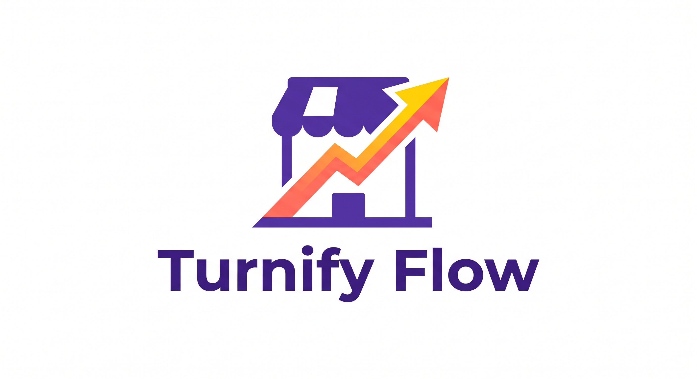
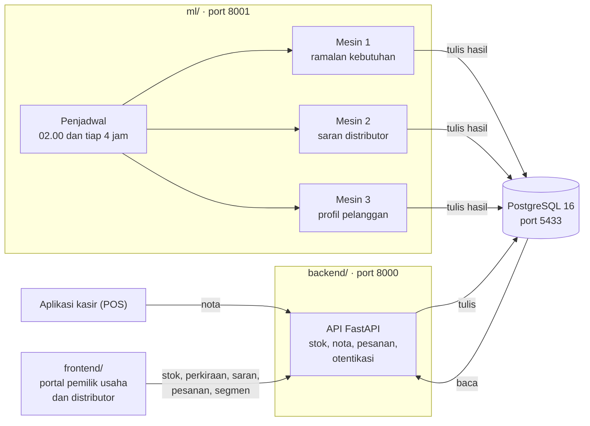
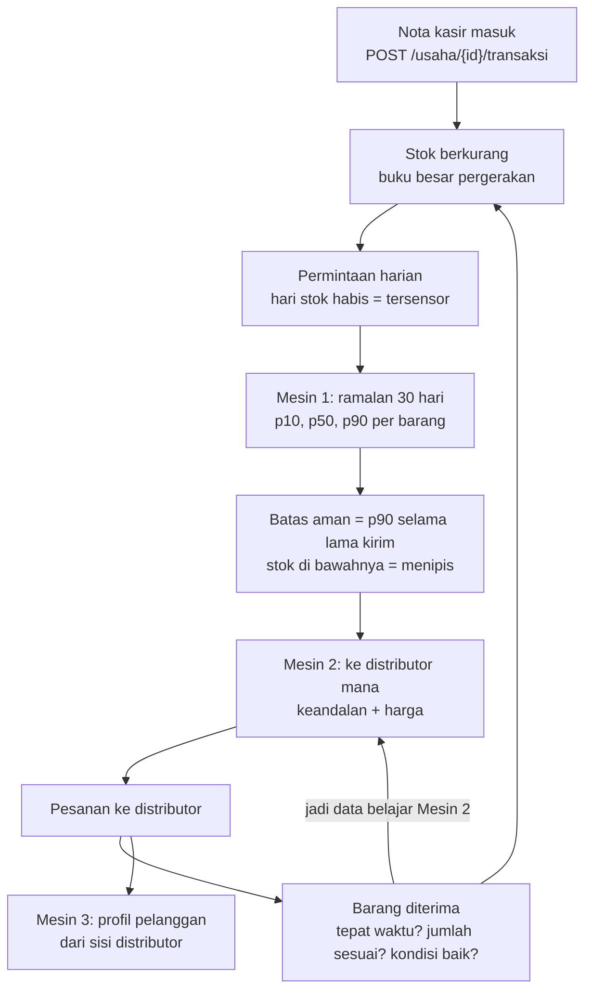

<p align="center">
  
</p>

# Turnify Flow

Sistem analitika rantai pasok untuk UMKM sebagai pendamping aplikasi kasir.
Turnify Flow tidak menggantikan kasir yang sudah dipakai warung. Ia membaca nota
dari kasir, menghitung sisa stok gudang, meramal kebutuhan pekan dan bulan
berikutnya, lalu menyarankan ke distributor mana sebaiknya memesan.

Project Analitika Data, Program Studi Sains Data Terapan, Politeknik Elektronika
Negeri Surabaya. Dosen pengampu: Dr. Edi Satriyanto, S.Si., M.Si.
Tim: Kadek Savita Dyutianaya, Ilham Bintang Satria, Raja Rahman Aziiz, Lailatul Maghfiroh.

---

## Arsitektur



Satu aturan memisahkan `api` dan `ml`: **layanan model menulis ke tabel, API membaca
tabel.** API tidak pernah memanggil model saat halaman dibuka. Kalau layanan model
mati, portal tetap terbuka dengan angka terakhir yang tersimpan, dan kolom
`tingkat_layanan` menyatakan bahwa angkanya tidak segar.

### Alur data, dari nota sampai pesanan



---

## Tiga mesin analitik

| Mesin | Pertanyaan yang dijawab | Model produksi | Pembanding | Hasil terkini |
| --- | --- | --- | --- | --- |
| **1** | Berapa banyak dan kapan harus memesan? | SARIMA(1,0,1)(0,1,1)₇ pada log unit, kalender sebagai peubah luar | ETS/Holt-Winters, Chronos-2, LightGBM, naif musiman | MAPE pekanan unit 14,8% (ETS 17,5%). Rentang p10–p90 terkalibrasi: cakupan 83,2%, sasaran 80%. Omset: SARIMAX 9,4% di simulasi, Chronos-2 4,0% di toko roti sungguhan |
| **2** | Ke distributor mana sebaiknya memesan barang ini? | Beta-Bernoulli + Thompson sampling + fuzzy Sugeno (keandalan × harga) | TOPSIS, BART, regresi logistik Bayesian, LinUCB | Regret 1.465 ± 26 (10 benih) vs TOPSIS 1.551. "Selalu termurah" lebih buruk daripada memilih acak |
| **3** | Pelanggan mana yang andal, mana yang mulai menjauh? (untuk distributor) | K-Prototypes atas RFM (frequency dan monetary di-log), jenis usaha, kategori | Gower + aglomeratif, Gower + HDBSCAN | Stabilitas segmen 0,913 (ARI subsampel 80%) |

Semua angka di atas berasal dari berkas di [`ml/hasil/`](ml/hasil/), dan setiap
perubahan model dicatat di sheet *Model Warungku → Catatan Perubahan*. Rincian
dan batas penafsirannya ada di [`docs/laporan/`](docs/laporan/) dan
[`ml/eksperimen/README.md`](ml/eksperimen/README.md).

> **Batas penting saat membaca angka.** Data warung berasal dari simulasi 400 hari
> dengan 70 UMKM yang kami rancang sendiri, termasuk keputusan membuat distributor
> termurah menjadi yang terburuk. Metode Mesin 1 juga diuji pada data toko roti
> sungguhan (French Bakery), tetapi belum pada warung Indonesia sungguhan.

---

## Struktur proyek

```
turnify-flow/
├── frontend/      # React + Vite: portal pemilik usaha dan portal distributor
├── backend/       # FastAPI: API, model tabel, migrasi basis data, uji
├── ml/            # Mesin 1, 2, 3, layanan model, percobaan, dan hasilnya
├── data/          # Pembangkit dataset simulasi dan data nyata pihak luar
├── docs/          # Laporan, dokumen proses bisnis, desain, aset, arsip
├── deployment/    # docker-compose (PostgreSQL, API, layanan model) dan Dockerfile backend
├── pyproject.toml # Satu proyek Python untuk backend, ml, dan data
├── requirements.txt           # Lingkungan lengkap: produksi + eksperimen (Chronos, PyMC, LightGBM)
└── requirements-produksi.txt  # Hanya yang dipakai model produksi; dipakai image Docker
```

| Folder | Isi |
| --- | --- |
| `frontend/src/` | Halaman (`pages/`), komponen, kerangka, store Zustand, klien API (`lib/api.ts`, `lib/apiPesanan.ts`), dan data contoh (`data/dummy.ts`) |
| `backend/api/` | Endpoint REST. Hanya membaca keluaran model, tidak pernah memanggilnya |
| `backend/warungku/` | Model tabel (SQLModel), enum, koneksi. Nama paketnya belum diganti |
| `backend/migrations/` | Migrasi Alembic |
| `backend/skrip/` | SQL pemeliharaan dan pemeriksaan konsistensi |
| `ml/mesin1/`, `mesin2/`, `mesin3/` | Kode ketiga mesin. Model produksi dipanggil dari `ml/layanan.py` |
| `ml/sumber/` | Satu pintu data untuk model: simulasi dan data nyata dengan bentuk yang sama |
| `ml/eksperimen/` | Percobaan penyetelan yang tidak mengubah kode produksi |
| `ml/hasil/` | Ringkasan hasil percobaan (`hasil_*.json`, dilacak git) |
| `data/dataset/` | Pembangkit dataset simulasi (D1 permintaan, D2 pesanan berlabel) |
| `data/data_nyata/` | Data nyata pihak luar; berkas CSV tidak dilacak karena lisensinya |
| `docs/laporan/` | Laporan Word/PDF dan pembangkitnya; angkanya dibaca dari `ml/hasil/` dan basis data |
| `deployment/` | `docker-compose.yml` dan `Dockerfile` image backend |

---

## Mulai cepat (pengembangan lokal)

Perintah untuk **Windows PowerShell**, dijalankan dari **akar repo**.

> Pakai branch **`Rombak#3`**. Branch `main` belum memuat backend dan model.

### Yang harus terpasang

| Kebutuhan | Versi | Cara memastikan |
| --- | --- | --- |
| Python | **3.12 atau lebih baru** (diuji pada 3.14.5) | `python --version` |
| Node.js | 18+ (diuji pada 24) | `node --version` |
| Docker Desktop | untuk PostgreSQL | `docker --version` |
| Git | — | `git --version` |

### 1. Clone

```powershell
git clone https://github.com/YonoBengkel/Warungku.git turnify-flow
cd turnify-flow
git switch "Rombak#3"
```

### 2. Basis data

```powershell
docker compose -f deployment/docker-compose.yml up -d
```

PostgreSQL berjalan di port **5433**, bukan 5432, supaya tidak bentrok dengan
PostgreSQL yang mungkin sudah ada di komputermu.

Image basis datanya, [`yonobengkel/turnify-flow-db`](https://hub.docker.com/r/yonobengkel/turnify-flow-db),
**sudah berisi data simulasi**: saat pertama dinyalakan dengan volume kosong, data
dipulihkan otomatis (sekitar satu menit). Dengan begitu langkah 3 (migrasi) dan
langkah 4 (dataset) **boleh dilewati**, kecuali kamu ingin membangkitkan ulang datanya.

### 3. Lingkungan Python

```powershell
python -m pip install -r requirements.txt
python -m pip install -e . --no-deps
copy backend\.env.example backend\.env
python -m alembic -c backend/alembic.ini upgrade head
```

Langkah `pip install -e .` membuat paket `api`, `warungku`, `ml`, dan `dataset`
bisa diimpor dari mana pun, walau foldernya terpisah. Bobot Chronos-2 diunduh dari
HuggingFace saat pertama dipakai, jadi perlu internet sekali.

### 4. Isi dataset simulasi

```powershell
python -m dataset.buat_dataset
```

Sekitar 10 menit. Perintah ini **mengosongkan lalu mengisi ulang** basis data,
termasuk keluaran model (`prediksi`, `rekomendasi_skor`, `segmen_pelanggan`).
Jalankan ketiga mesin lagi sesudahnya (langkah 6).

Periksa datanya konsisten (keenam angkanya harus 0):

```powershell
Get-Content backend\skrip\02_periksa_konsistensi.sql | docker exec -i warungku-db psql -U warungku -d warungku_dev
```

### 5. Uji otomatis

```powershell
python -m pytest -q
```

Menjalankan `backend/uji` dan `ml/uji` (104 uji). Sebagian uji membutuhkan basis
data dari langkah 2 sampai 4. Uji backend membuat dan menghapus datanya sendiri,
jadi tidak mengubah data simulasi.

### 6. Jalankan

Masing-masing di terminal sendiri. **Kedua perintah `uvicorn` wajib jalan**: tanpa
API (port 8000) dan layanan model (port 8001), halaman yang membutuhkan server,
misalnya *Pelanggan* di portal distributor, menampilkan "Server belum menyala",
dan portal pemilik usaha hanya memakai data contoh. Kalau tidak ingin memakai
`uvicorn`, nyalakan keduanya dengan Docker (lihat
[Menjalankan API dan layanan model dengan Docker](#menjalankan-api-dan-layanan-model-dengan-docker));
pilih salah satu, jangan keduanya, karena portnya sama.

```powershell
python -m uvicorn api.utama:app --port 8000
```

```powershell
python -m uvicorn ml.layanan:app --port 8001
```

```powershell
npm install
npm run dev
```

`npm install` dan `npm run dev` di akar repo diteruskan ke `frontend/`.

Lalu isi keluaran ketiga mesin sekali (sesudah itu penjadwal yang menjalankannya):

```powershell
curl.exe -X POST localhost:8001/mesin1/jalankan -H "Content-Type: application/json" -d "{}"
curl.exe -X POST localhost:8001/mesin2/jalankan -H "Content-Type: application/json" -d "{}"
curl.exe -X POST localhost:8001/mesin3/jalankan
```

| Alamat | Isi |
| --- | --- |
| http://localhost:5173 | Portal pemilik usaha dan distributor |
| http://localhost:8000/docs | Dokumentasi API interaktif |
| http://localhost:8001/docs | Dokumentasi layanan model |

> Tulis `curl.exe`, bukan `curl`. Di PowerShell, `curl` adalah alias
> `Invoke-WebRequest` yang tidak mengenal `-X`.

**Data contoh atau data server.** Tanpa login sungguhan, portal memakai data contoh
di memori. Untuk melihat keluaran mesin analitik:

- **Portal pemilik usaha:** di halaman Masuk pilih tab *Pakai Email* lalu tekan
  *Isikan akun simulasi* (`umkm1@warungku.test`, usaha Kopi Kita Jogja). Stok,
  perkiraan SARIMA, Prediksi, saran distributor, dan pesanan dibaca dari API.
- **Portal distributor:** menu *Pelanggan* atau *Pesanan* → *Sambungkan ke server*
  → *Isikan akun simulasi* (`distributor1@warungku.test`, Sumber Tani Nusantara).

Kata sandi semua akun simulasi adalah `KATA_SANDI_CONTOH` di
[`data/dataset/buat_dataset.py`](data/dataset/buat_dataset.py). Kalau server mati,
portal tetap terbuka dengan data contoh dan memberi tahu bahwa datanya contoh.

Isi `WARUNGKU_RAHASIA` di `backend/.env` dengan teks acak yang panjang. Tanpanya
API membuat rahasia baru setiap kali dinyalakan, dan semua orang harus masuk ulang.

### Menjalankan API dan layanan model dengan Docker

Kalau tidak ingin memasang lingkungan Python untuk menjalankan layanan, API dan
layanan model tersedia sebagai image Docker:
[`yonobengkel/turnify-flow-backend`](https://hub.docker.com/r/yonobengkel/turnify-flow-backend).
Satu image untuk dua layanan; isinya hanya model produksi (SARIMA, Beta-Bernoulli
+ Thompson + fuzzy, K-Prototypes), tanpa Chronos, PyMC, atau LightGBM.

```powershell
docker compose -f deployment/docker-compose.yml --profile layanan up -d
```

Perintah ini menyalakan basis data (port 5433), API (port 8000), dan layanan model
(port 8001). Image diunduh dari Docker Hub; kalau tidak bisa, Compose membangunnya
dari [`deployment/Dockerfile`](deployment/Dockerfile). Tanpa `--profile layanan`,
yang menyala hanya basis data, seperti di langkah 2.

```powershell
docker compose -f deployment/docker-compose.yml --profile layanan stop api ml
```

Hal yang perlu diketahui:

- **Data sudah ikut.** Image basis data `turnify-flow-db` membawa seluruh data
  simulasi beserta keluaran ketiga mesin, jadi di komputer baru tidak perlu Python
  sama sekali. Akun simulasi `umkm1` dan `distributor1` langsung bisa dipakai.
- **Volume lama yang kosong tidak diisi ulang.** Data hanya dipulihkan ke volume yang
  belum pernah dipakai. Kalau sebelumnya pernah menyalakan basis data versi lama
  (image `postgres` biasa, datanya kosong), hapus volumenya sekali lalu nyalakan lagi:
  `docker compose -f deployment/docker-compose.yml down -v`. **Jangan** jalankan
  perintah itu di komputer yang basis datanya sudah berisi data yang ingin disimpan.
- **Penjadwal ikut menyala** di kontainer `turnify-ml`: Mesin 1 pukul 02.00 WIB,
  Mesin 2 dan 3 setiap empat jam, dan hasilnya ditulis ke basis data.
- **Rahasia tidak ada di dalam image.** Isi `WARUNGKU_RAHASIA` di `deployment/.env`
  (berkas ini tidak dilacak git) supaya login tidak hangus setiap kontainer dinyalakan ulang.
- **Jangan jalankan bersamaan** dengan `uvicorn` lokal: keduanya memakai port 8000 dan 8001.

Image basis data dibangun dari cadangan basis data lokal
([`deployment/db/`](deployment/db/)). Cadangannya tidak dilacak git. Isinya data
simulasi buatan tim, termasuk akun uji yang kata sandinya terbuka di kode; tidak
ada data pihak luar.

```powershell
docker exec warungku-db pg_dump -U warungku -d warungku_dev -Fc -Z 9 --no-owner --no-privileges -f /tmp/warungku_dev.dump
docker cp warungku-db:/tmp/warungku_dev.dump deployment/db/warungku_dev.dump
docker exec warungku-db rm /tmp/warungku_dev.dump
docker build -t yonobengkel/turnify-flow-db:0.1.0 deployment/db
docker push yonobengkel/turnify-flow-db:0.1.0
```

Membangun dan mengunggah image versi baru (pemilik repositori Docker Hub):

```powershell
docker build -f deployment/Dockerfile -t yonobengkel/turnify-flow-backend:0.1.0 .
docker login
docker push yonobengkel/turnify-flow-backend:0.1.0
```

Naikkan nomor versinya (dan nomor di `deployment/docker-compose.yml`) setiap kali
kode backend atau model berubah.

### Opsional

- **MOIRAI sebagai pembanding Mesin 1** butuh lingkungan terpisah (Python 3.12,
  `ml/requirements-ml.txt`), karena `uni2ts` memaku versi scipy yang tidak punya
  wheel untuk Python 3.14. Lisensi bobotnya CC-BY-NC-4.0 (non-komersial).
- **Data toko roti sungguhan** untuk validasi Mesin 1: cara mengunduhnya di
  [`data/data_nyata/french_bakery/README.md`](data/data_nyata/french_bakery/README.md).
- **Laporan progres untuk dosen** (Word dan PDF) dibangun ulang dari berkas hasil
  dan basis data: `python docs/laporan/bangun_laporan_dosen.py`. Laporan teknis
  lama: `python docs/laporan/bangun_laporan.py`.

---

## Endpoint

### API utama (port 8000)

| Method | Endpoint | Keterangan |
| --- | --- | --- |
| POST | `/auth/umkm/daftar` | Buat akun pemilik usaha beserta usahanya (satu akun, satu usaha) |
| POST | `/auth/umkm/masuk` | Masuk sebagai pemilik usaha |
| POST | `/auth/distributor/masuk` | Masuk sebagai distributor |
| GET | `/auth/saya` | Siapa pemegang token ini |
| GET | `/usaha/{usaha_id}/barang` | Daftar barang di gudang, termasuk pemakaian rata-rata 28 hari dan harga per satuan |
| GET | `/usaha/{usaha_id}/barang/{barang_id}/perkiraan` | Perkiraan terbaru Mesin 1 (p10, p50, p90 per hari), dibaca dari tabel |
| GET | `/usaha/{usaha_id}/barang/{barang_id}/riwayat` | Pemakaian harian terakhir; hari stok habis ditandai |
| GET | `/usaha/{usaha_id}/barang/{barang_id}/saran` | Saran distributor terbaru Mesin 2, dibaca dari tabel |
| GET | `/usaha/{usaha_id}/pemakaian-bulanan` | Pemakaian per 30 hari dan perkiraan 30 hari ke depan, semua barang |
| POST | `/usaha/{usaha_id}/transaksi` | Terima satu nota kasir; aman dikirim ulang |
| GET | `/usaha/{usaha_id}/pesanan` | Pesanan usaha ini beserta baris dan jejaknya |
| POST | `/usaha/{usaha_id}/pesanan` | Kirim keranjang; satu pesanan per distributor, harga disalin saat itu |
| GET | `/usaha/{usaha_id}/pesanan/{pesanan_id}` | Rincian satu pesanan |
| POST | `/usaha/{usaha_id}/pesanan/{pesanan_id}/batal` | Batalkan pesanan yang belum dijawab distributor |
| POST | `/usaha/{usaha_id}/pesanan/{pesanan_id}/terima` | Hitung barang yang datang: stok naik, data latih Mesin 2 tertulis |
| GET | `/distributor/{distributor_id}/pesanan` | Ringkasan pesanan yang masuk, terbaru dulu |
| GET | `/distributor/{distributor_id}/pesanan-masuk` | Pesanan masuk lengkap dengan baris, jejak, dan profil pemesan |
| GET | `/distributor/{distributor_id}/pesanan/{pesanan_id}` | Rincian satu pesanan masuk |
| POST | `/distributor/{distributor_id}/pesanan/{pesanan_id}/konfirmasi` | Terima pesanan; status menjadi disiapkan |
| POST | `/distributor/{distributor_id}/pesanan/{pesanan_id}/tolak` | Tolak dengan alasan; status menjadi batal |
| POST | `/distributor/{distributor_id}/pesanan/{pesanan_id}/kirim` | Barang berangkat; status menjadi dikirim |
| POST | `/distributor/{distributor_id}/pesanan/{pesanan_id}/sampai` | Bukti antar; stok baru naik setelah pemilik usaha menerima |
| GET | `/distributor/{distributor_id}/segmen` | Ringkasan segmen pelanggan (Mesin 3) |
| GET | `/distributor/{distributor_id}/segmen/{segmen}` | Anggota satu segmen beserta angka RFM-nya |
| GET | `/sehat` | Keadaan layanan dan basis data |

Token pemilik usaha dan token distributor berbeda jenis: portal distributor tidak
bisa dibuka dengan token pemilik usaha, walau alamatnya ditebak. Urutan status
pesanan dijaga server: langkah yang dilompati ditolak dengan 409.

### Layanan model (port 8001)

| Method | Endpoint | Keterangan |
| --- | --- | --- |
| POST | `/mesin1/jalankan` | Jalankan Mesin 1, tulis ke `prediksi` (memblokir) |
| POST | `/mesin1/jadwalkan` | Sama, di latar; jalur yang dipakai penjadwal |
| POST | `/mesin2/jalankan` | Nilai kandidat distributor, tulis ke `rekomendasi_skor` |
| POST | `/mesin3/jalankan` | Segmentasi pelanggan tiap distributor, tulis ke `segmen_pelanggan` |
| GET | `/jadwal` | Apa yang dijadwalkan, kapan berikutnya, hasil terakhirnya |
| GET | `/sehat` | Keadaan basis data dan jumlah baris keluaran tiap mesin |

Penjadwal hidup di dalam layanan model: Mesin 1 setiap hari pukul 02.00 WIB,
Mesin 2 dan 3 setiap empat jam. Matikan dengan `WARUNGKU_JADWAL=0` kalau
dijadwalkan dari luar.

---

## Yang belum selesai

Daftar ini ada supaya tidak ada yang menyangka bagian ini sudah selesai.

- **Sebagian portal masih data contoh.** Yang sudah membaca server: stok,
  perkiraan, Prediksi, saran distributor, pesanan (buat, terima, batal, dan aksi
  distributor), serta segmen pelanggan. Yang masih data contoh: keranjang dan
  katalog penawaran, kontrak, promo, notifikasi, dan profil. Dari data server,
  pesanan saat ini dibuat lewat tombol *Pesan* di kartu saran Mesin 2.
- **Portal distributor belum punya halaman masuk sendiri.** Sambungannya lewat
  kartu *Sambungkan ke server* di menu Pelanggan dan Pesanan.
- **Bukti antar** (kurir, pengantar, nomor resi) belum ditanyakan portal
  distributor; di rincian pesanan tertulis "Belum dicatat".
- **Konektor POS.** Kontrak nota sudah ada dan teruji (idempoten); penyambung ke
  aplikasi kasir tertentu belum dibuat.
- **Target MAPE 5% dosen.** Tercapai untuk omset toko roti sungguhan (4,0%, hanya
  6 pekan uji), belum untuk unit per barang per pekan (14,8%).
- **Warna merek** berpindah dari teal ke ungu logo (token di `frontend/src/index.css`).
  Satu warna grafik (`--c-seri-3`) masih terlalu mirip ungu merek dan belum diputuskan.
- **Nama internal** (paket `warungku`, basis data `warungku_dev`) belum diganti
  ke Turnify Flow; yang sudah diganti hanya teks yang terlihat pengguna.
- **OTP WhatsApp, penyegaran token, resep berbilang bahan:**
  ditunda atas keputusan tim. Rinciannya di [`backend/README.md`](backend/README.md).

---

## Dokumentasi

| Dokumen | Isi |
| --- | --- |
| [`docs/laporan/`](docs/laporan/) | Laporan progres untuk dosen (Word dan PDF), laporan implementasi lengkap dan ringkas |
| [`docs/proses-bisnis/`](docs/proses-bisnis/) | Dokumen proses bisnis, flowchart B2B/B2C, Gantt |
| [`docs/desain/`](docs/desain/) | Spesifikasi antarmuka, laporan revisi UI, bahan rebrand |
| [`backend/README.md`](backend/README.md) | Aturan angka, invarian buku besar, port 5433 |
| [`ml/README.md`](ml/README.md) | Layanan model dan cara menjalankan percobaan |
| [`ml/sumber/README.md`](ml/sumber/README.md) | Kontrak bentuk data untuk ketiga mesin |
| [`ml/eksperimen/README.md`](ml/eksperimen/README.md) | Hasil penyetelan Mesin 2 dan 3 |
