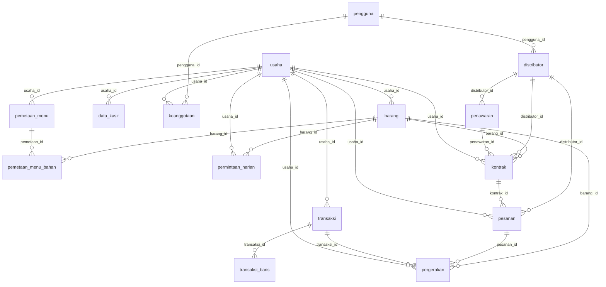

# Skema basis data Turnify Flow

Tabel, relasi, batasan, dan akses basis data PostgreSQL 16. Daftar ini dibuat dari model di `backend/warungku/model/`,
dan kodenya yang berlaku kalau keduanya berbeda. Tidak ada data sungguhan di sini.

## Migrasi dan akses

- **Migrasi:** Alembic, di `backend/migrations/versions/`. Jalankan `python -m alembic -c backend/alembic.ini upgrade head`.
- **Akses:** row-level security tidak dipakai. Semua akses lewat API, dan token diperiksa `usaha_saya` atau `distributor_saya`
  (`backend/api/otentikasi.py`), sehingga satu usaha tidak bisa membaca data usaha lain.
- **Pemisahan tugas:** layanan model menulis tabel analitik, API hanya membacanya.
- **Idempotensi nota:** `transaksi` unik per `usaha_id` dan `nomor_struk`, jadi nota yang dikirim ulang tidak memotong stok dua kali.
- **Buku besar stok:** `pergerakan` hanya ditambah, tidak pernah diubah atau dihapus.

## Relasi inti

## Inti: akun dan usaha

| Tabel | Isi | Kunci asing | Batasan |
|---|---|---|---|
| `berkas` | Bukti transfer dan foto pengiriman. | - | - |
| `pengguna` | Akun. Masuk memakai NOMOR HP, bukan email — itu yang dijanjikan layar Daftar, dan itu yang dipunyai pemilik warung. | - | unik (nomor_hp) |
| `produk_master` | !!! abstract "Usage Documentation"     [Models](../concepts/models.md) | - | cek `ck_produk_master_satuan`; unik (nama_kanonik) |
| `usaha` | UMKM. Satu usaha bisa dipegang beberapa pengguna lewat `keanggotaan`. | - | - |
| `distributor` | Pemasok. `kategori` dan `area_kirim` bukan hiasan profil — keduanya adalah MASUKAN LAPIS 1 Mesin 2 (penyaring kelayakan), jadi ia wajib terstruktur, bukan teks bebas. | `pengguna_id` ke `pengguna` | - |
| `keanggotaan` | Siapa boleh berbuat apa di satu usaha. | `pengguna_id` ke `pengguna`, `usaha_id` ke `usaha` | unik (pengguna_id) |

## Referensi

| Tabel | Isi | Kunci asing | Batasan |
|---|---|---|---|
| `hari_libur_nasional` | Tanggal merah dan cuti bersama, mengutip SKB 3 Menteri. | - | - |

## Gudang: stok, menu, dan nota kasir

| Tabel | Isi | Kunci asing | Batasan |
|---|---|---|---|
| `barang` | Satu baris stok di gudang UMKM. | `produk_master_id` ke `produk_master`, `usaha_id` ke `usaha` | unik (usaha_id, kode_barang); cek `ck_barang_stok_tak_negatif` |
| `data_kasir` | Keadaan sambungan POS per usaha. Satu baris per usaha. | `usaha_id` ke `usaha` | unik (usaha_id) |
| `pemetaan_menu` | Jembatan antara nama menu di struk kasir dan bahan di gudang. | `usaha_id` ke `usaha` | unik (usaha_id, nama_menu) |
| `transaksi` | Satu struk dari kasir, apa adanya. | `usaha_id` ke `usaha` | unik (usaha_id, nomor_struk) |
| `kemasan` | Lapisan tampilan: 1 dus = 1.000 pcs. `isi` selalu dalam satuan dasar barang. | `barang_id` ke `barang` | unik (barang_id, nama) |
| `pemetaan_menu_bahan` | Satu bahan dalam satu menu, beserta takarannya dalam satuan dasar barang. | `barang_id` ke `barang`, `pemetaan_id` ke `pemetaan_menu` | cek `ck_takaran_positif`; unik (pemetaan_id, barang_id) |
| `transaksi_baris` | Satu baris struk. | `transaksi_id` ke `transaksi` | - |
| `pergerakan` | Buku besar stok. Hanya ditambah, tidak pernah diubah atau dihapus. | `barang_id` ke `barang`, `pesanan_id` ke `pesanan`, `produksi_id` ke `produksi`, `transaksi_id` ke `transaksi`, `usaha_id` ke `usaha` | - |

## Produksi: UMKM produsen

| Tabel | Isi | Kunci asing | Batasan |
|---|---|---|---|
| `pembeli` | Usaha lain yang membeli produk jadi: ritel modern, toko oleh-oleh, katering. | `usaha_id` ke `usaha` | unik (usaha_id, nama) |
| `produk_jadi` | Barang hasil produksi yang dijual ke usaha lain, mis. "Sambal Bawang 200 g". | `usaha_id` ke `usaha` | unik (usaha_id, nama); cek `ck_produk_jadi_stok_tak_negatif` |
| `penjualan` | Satu kiriman produk jadi ke satu pembeli. | `pembeli_id` ke `pembeli`, `usaha_id` ke `usaha` | unik (usaha_id, nomor) |
| `produksi` | Satu sesi masak: sekian satuan produk jadi, memotong bahan sesuai resep. | `produk_jadi_id` ke `produk_jadi`, `usaha_id` ke `usaha` | cek `ck_produksi_jumlah_positif` |
| `resep_bahan` | Satu bahan untuk SATU satuan produk jadi, dalam satuan dasar barang. | `barang_id` ke `barang`, `produk_jadi_id` ke `produk_jadi` | unik (produk_jadi_id, barang_id); cek `ck_resep_takaran_positif` |
| `penjualan_baris` | !!! abstract "Usage Documentation"     [Models](../concepts/models.md) | `penjualan_id` ke `penjualan`, `produk_jadi_id` ke `produk_jadi` | cek `ck_penjualan_jumlah_positif` |

## Niaga: distributor, pesanan, kontrak, promo

| Tabel | Isi | Kunci asing | Batasan |
|---|---|---|---|
| `notifikasi` | !!! abstract "Usage Documentation"     [Models](../concepts/models.md) | `barang_id` ke `barang`, `distributor_id` ke `distributor`, `usaha_id` ke `usaha` | - |
| `penawaran` | Satu barang yang dijual satu distributor. | `distributor_id` ke `distributor`, `produk_master_id` ke `produk_master` | cek `ck_penawaran_isi_positif` |
| `promo` | Potongan dari distributor. Berlaku untuk beli sekali, TIDAK untuk harga kontrak. Promo tidak pernah dihapus, hanya diakhiri — pesanan lama masih perlu menyebut promo mana asal potongannya. | `distributor_id` ke `distributor` | - |
| `paket_kontrak` | Tawaran kontrak untuk SATU penawaran. | `distributor_id` ke `distributor`, `penawaran_id` ke `penawaran` | unik (penawaran_id, durasi_bulan) |
| `promo_penawaran` | !!! abstract "Usage Documentation"     [Models](../concepts/models.md) | `penawaran_id` ke `penawaran`, `promo_id` ke `promo` | unik (promo_id, penawaran_id) |
| `tingkat_keanggotaan` | Keuntungan per tingkat untuk promo keanggotaan, diisi distributor. | `promo_id` ke `promo` | - |
| `kontrak` | Kesepakatan berjalan. Satu kontrak mengikat tepat satu barang. | `barang_id` ke `barang`, `distributor_id` ke `distributor`, `paket_id` ke `paket_kontrak`, `penawaran_id` ke `penawaran`, `usaha_id` ke `usaha` | - |
| `kontrak_periode` | Pemenuhan kuota per bulan. Tabel tersendiri, bukan JSON: ini sering dikueri (bar kuota, daftar kontrak, rekap distributor) dan perlu diindeks. | `kontrak_id` ke `kontrak` | unik (kontrak_id, periode) |
| `pesanan` | Satu pesanan, dibaca dua portal. | `distributor_id` ke `distributor`, `kontrak_id` ke `kontrak`, `usaha_id` ke `usaha` | unik (nomor) |
| `pesanan_baris` | Satu barang dalam satu pesanan. | `barang_id` ke `barang`, `penawaran_id` ke `penawaran`, `pesanan_id` ke `pesanan`, `promo_id` ke `promo` | - |
| `pesanan_jejak` | Garis waktu status. Dibaca dua portal dengan kalimat yang berbeda. | `pesanan_id` ke `pesanan` | - |
| `ulasan` | Penilaian setelah pesanan selesai. Satu pesanan satu ulasan. | `distributor_id` ke `distributor`, `pesanan_id` ke `pesanan`, `usaha_id` ke `usaha` | cek `ck_ulasan_rating`; unik (pesanan_id) |

## Analitik: keluaran mesin

| Tabel | Isi | Kunci asing | Batasan |
|---|---|---|---|
| `permintaan_harian` | Permintaan satu barang pada satu hari, dalam satuan dasar. | `barang_id` ke `barang`, `usaha_id` ke `usaha` | unik (usaha_id, barang_id, tanggal) |
| `prediksi` | Keluaran Mesin 1: satu baris per barang per hari target. | `barang_id` ke `barang`, `usaha_id` ke `usaha` | unik (barang_id, tanggal_target, jalan_id) |
| `rekomendasi_skor` | Keluaran Mesin 2, disinggahkan (cache) karena skornya bergantung keadaan saat itu: stok, harga, dan promo yang sedang berjalan. | `barang_id` ke `barang`, `distributor_id` ke `distributor`, `penawaran_id` ke `penawaran`, `usaha_id` ke `usaha` | - |
| `fitur_pesanan` | Satu baris per pesanan selesai: fitur + label. **Tabel latih Mesin 2.** | `distributor_id` ke `distributor`, `pesanan_id` ke `pesanan`, `usaha_id` ke `usaha` | unik (pesanan_id) |

## Segmen pelanggan

| Tabel | Isi | Kunci asing | Batasan |
|---|---|---|---|
| `segmen_pelanggan` | Satu baris per (distributor, pelanggan): segmen beserta fitur RFM-nya. | `distributor_id` ke `distributor`, `usaha_id` ke `usaha` | unik (distributor_id, usaha_id, jalan_id) |
